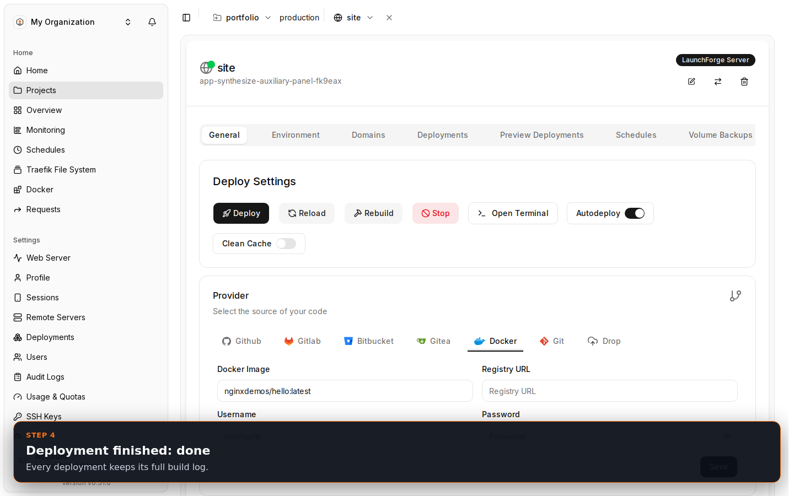
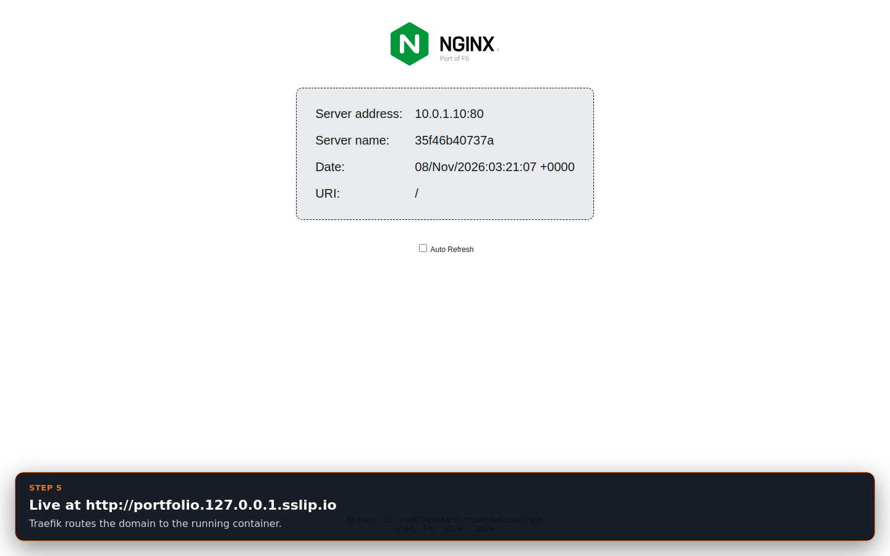
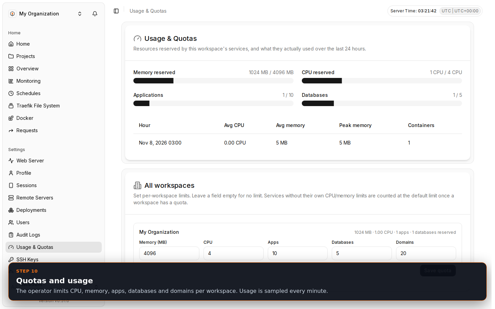
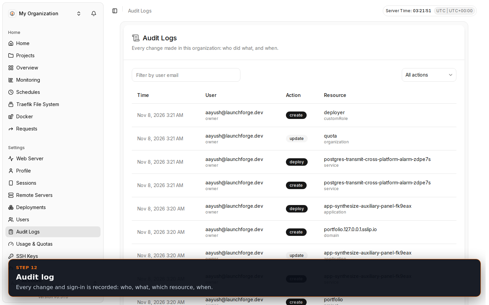
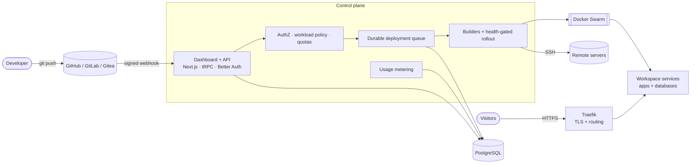

<div align="center">


# LaunchForge OS

**Push to Git. Ship to production. On servers you own.**

A self-hosted Platform-as-a-Service for teams: Git-to-production deployments, managed databases, domains with automatic HTTPS, monitoring, backups and rollbacks — with the isolation, quotas and reliability needed for several teams to share one installation safely.

[](https://github.com/Aayushajs/LaunchForge-OS/actions/workflows/ci.yml)
[](https://github.com/Aayushajs/LaunchForge-OS/actions/workflows/installer.yml)
[](https://github.com/Aayushajs/LaunchForge-OS/actions/workflows/codeql.yml)
[](https://github.com/Aayushajs/LaunchForge-OS/actions/workflows/release.yml)
[](LICENSE)

[Quickstart](docs/guide/02-quickstart.md) · [Documentation](docs/README.md) · [Engineering case study](docs/engineering/CASE_STUDY.md) · [Architecture](docs/02-architecture/SYSTEM_ARCHITECTURE.md) · [Roadmap](docs/engineering/ROADMAP.md)

</div>

```bash
curl -fsSL https://raw.githubusercontent.com/Aayushajs/LaunchForge-OS/main/scripts/install.sh | sudo bash
```

---

## Demo

**▶ [Watch the demo video](docs/assets/demo/launchforge-demo.mp4)** — recorded on a fresh Ubuntu server right after a real install: signup, deploy, live site, database, security policy, quotas, audit log. [Step-by-step walkthrough with screenshots](docs/DEMO.md).

<table>
  <tr>
    <td><a href="docs/DEMO.md#deployment-finished"></a></td>
    <td><a href="docs/DEMO.md#the-deployed-app-served-through-traefik"></a></td>
  </tr>
  <tr>
    <td><a href="docs/DEMO.md#usage--quotas-operator-view"></a></td>
    <td><a href="docs/DEMO.md#audit-log"></a></td>
  </tr>
</table>

## Table of contents

- [Demo](#demo)
- [Why LaunchForge](#why-launchforge)
- [Features](#features)
- [Architecture](#architecture)
- [Getting started](#getting-started)
- [What you can do, and where](#what-you-can-do-and-where)
- [Configuration](#configuration)
- [Security model](#security-model)
- [Performance](#performance)
- [Documentation](#documentation)
- [Repository layout](#repository-layout)
- [Local development](#local-development)
- [Testing](#testing)
- [CI/CD](#cicd)
- [Releases and versioning](#releases-and-versioning)
- [Roadmap](#roadmap)
- [FAQ](#faq)
- [Contributing](#contributing)
- [License](#license)

## Why LaunchForge

Most self-hosted PaaS tools assume one trusted owner. LaunchForge starts from an established open-source deployment engine and adds what multi-team use needs:

| Problem in a shared installation | What LaunchForge does | Where |
|---|---|---|
| A service can mount `docker.sock` or `/` and take over the host | **Workload policy** rejects dangerous mounts and compose settings at save and deploy time | [`workload-policy.ts`](packages/server/src/utils/security/workload-policy.ts) |
| A team can wire another team's GitHub installation, registry or SSH key into its app | **Central reference ownership** checks on every service mutation | [`reference-access.ts`](packages/server/src/services/reference-access.ts) |
| Any team can claim a hostname another team serves | **Hostname ownership** with normalization (case, trailing dot, punycode) | [`domain-ownership.ts`](packages/server/src/services/domain-ownership.ts) |
| A crash-looping release is reported as "done" | **Health-gated rollouts**: done only when Swarm runs the new version; automatic rollback | [`rollout.ts`](packages/server/src/utils/builders/rollout.ts) |
| A restart loses queued deployments | **Durable queue** persisted in PostgreSQL and replayed on start | [`in-memory-queue.ts`](apps/dokploy/server/queues/in-memory-queue.ts) |
| One team can starve the server | **Quotas** (CPU, memory, apps, databases, domains) with default limits + **per-minute metering** | [`workspace-quota.ts`](packages/server/src/services/workspace-quota.ts), [`collector.ts`](packages/server/src/utils/metering/collector.ts) |
| Credentials stored in plaintext | **AES-256-GCM encryption at rest** for 27 credential columns | [ER model](docs/04-database/ER_DIAGRAM.md#encrypted-columns) |
| Forged or GET-triggered deploy webhooks | **Raw-body HMAC verification**, POST only | [`webhook-auth.ts`](apps/dokploy/server/utils/webhook-auth.ts) |
| Manual, risky installs and upgrades | **One-command installer** with generated secrets, pre-upgrade backup and automatic rollback, tested end to end in CI | [`install.sh`](scripts/install.sh) |

Read the full story in the [engineering case study](docs/engineering/CASE_STUDY.md).

## Features

**Deploy anything**
- GitHub App, GitLab, Gitea, Bitbucket or any Git URL; auto-deploy on push with branch, tag and watch-path filters; preview environments per pull request
- Nixpacks, Railpack, Heroku and Paketo buildpacks, Dockerfile, static sites — Node.js, Next.js, React, Python, PHP, Go, Java, Ruby, Rust and more
- Prebuilt images from any registry, zip uploads, Docker Compose stacks, one-click templates, AI-generated stacks

**Run it reliably**
- Zero-downtime start-first rollouts, health checks, automatic rollback, registry-backed rollbacks to any earlier deployment
- Replicas, CPU/memory limits, placement across Swarm nodes, remote deploy servers and dedicated build servers
- Build timeouts, scoped cancellation, restart-safe deployment queue

**Data**
- Managed PostgreSQL, MySQL, MariaDB, MongoDB, Redis and libSQL
- Scheduled backups to any S3-compatible storage, streaming restore, volume backups

**Networking**
- Custom domains with automatic Let's Encrypt certificates, path routing, redirects, basic auth, Traefik middlewares
- DNS provider integration (Cloudflare, Route 53, Porkbun, Infomaniak, OVH)

**Operate**
- Live logs, web terminal, host and container metrics, alerts to 12 channels, log/metric shipping to Datadog, Loki, Elasticsearch and others
- Per-workspace usage and quotas, audit log of every change

**Teams**
- Workspaces, invitations, owner/admin/member roles, custom roles, per-member access to projects, services and servers
- API keys, REST/OpenAPI and tRPC APIs, 2FA and passkeys

## Architecture



Details: [system architecture](docs/02-architecture/SYSTEM_ARCHITECTURE.md) · [HLD](docs/03-design/HLD.md) · [LLD](docs/03-design/LLD.md) · [12 architecture decision records](docs/02-architecture/ARCHITECTURE_DECISIONS.md) · [data model](docs/04-database/ER_DIAGRAM.md) · [threat model](docs/06-security/THREAT_MODEL.md)

## Getting started

### 1. Requirements

| | Minimum | Recommended |
|---|---|---|
| OS | Ubuntu 22.04 / 24.04, Debian 12 | Ubuntu 24.04 LTS |
| CPU | 1 vCPU, x86_64 or arm64 | 2+ vCPU |
| Memory | 2 GB | 4 GB+ |
| Disk | 20 GB free | 40 GB+ SSD |
| Network | Public IP; TCP 22, 80, 443, 3000 open | A domain name |

### 2. Install

```bash
curl -fsSL https://raw.githubusercontent.com/Aayushajs/LaunchForge-OS/main/scripts/install.sh | sudo bash
```

| Step | What happens | Safe to re-run |
|---|---|---|
| Preflight | OS, architecture, RAM, disk, free ports; refuses to run inside a container | ✓ |
| Docker | Installed if missing | ✓ |
| Swarm | Initialized on the server's primary IP (`--advertise-addr` to override) | ✓ |
| Secrets | Database password, session secret and encryption key generated as Docker secrets: no defaults, nothing in plain text on disk | ✓ |
| PostgreSQL 16 | Platform database with a persistent volume | ✓ |
| Traefik | Reverse proxy with automatic Let's Encrypt | ✓ |
| Dashboard | Started, then health-checked for up to 5 minutes | ✓ |

Pin a version with `--version 0.1.0`; see every flag with `--help`.

### 3. First login

Open `http://<server-ip>:3000` and create the owner account. The first account is the **platform operator** and can set quotas for every workspace.

### 4. Deploy your first app

1. **Projects → Create Project** (`portfolio`).
2. Add an **Application**, choose a provider (GitHub, GitLab, Gitea, Bitbucket, any Git URL, Docker image or zip) and a build type (Nixpacks auto-detects most languages).
3. **Deploy** and follow the build log in **Deployments**.
4. **Domains → Add Domain**: your host, the container port, HTTPS with Let's Encrypt.
5. Turn on **Autodeploy**: every `git push` now ships, and a broken release never replaces a healthy one.

Full walkthrough: [Quickstart](docs/guide/02-quickstart.md) → [Tutorial: deploy your portfolio](docs/guide/03-tutorial-portfolio.md).

### 5. Operate

```bash
sudo bash install.sh status              # health of every component
sudo bash install.sh upgrade             # database backup → upgrade → automatic rollback if unhealthy
sudo bash install.sh uninstall [--purge] # remove services (and, with --purge, all data)
```

## What you can do, and where

| Task | In the dashboard | Guide |
|---|---|---|
| Deploy from Git with auto-deploy on push | Application → General | [Applications](docs/guide/04-applications.md) |
| Preview environment per pull request | Application → Preview Deployments | [Applications](docs/guide/04-applications.md#preview-deployments-github) |
| Environment variables, build args, build secrets | Application → Environment | [Applications](docs/guide/04-applications.md#configuration) |
| Health checks, replicas, CPU/memory limits | Application → Advanced | [Applications](docs/guide/04-applications.md#health-checks-and-zero-downtime-releases) |
| Roll back to an earlier version | Application → Deployments | [Applications](docs/guide/04-applications.md#rollbacks) |
| Live logs, web terminal, metrics | Application → Logs / Monitoring | [Monitoring](docs/guide/10-monitoring.md) |
| PostgreSQL, MySQL, MariaDB, MongoDB, Redis, libSQL | Environment → Create database | [Databases](docs/guide/05-databases.md) |
| Scheduled backups to S3 and restore | Database → Backups; Settings → S3 Destinations | [Databases](docs/guide/05-databases.md#backups) |
| Custom domains, HTTPS, redirects, basic auth | Service → Domains / Advanced | [Domains](docs/guide/06-domains.md) |
| Multi-container apps and one-click templates | Create Compose / Create from Template | [Compose](docs/guide/07-compose.md) |
| Invite people, roles, custom roles | Settings → Users | [Teams](docs/guide/08-teams-and-access.md) |
| See who changed what | Settings → Audit Logs | [Teams](docs/guide/08-teams-and-access.md#audit-log) |
| Usage and per-workspace quotas | Settings → Usage & Quotas | [Monitoring](docs/guide/10-monitoring.md#usage--quotas) |
| Remote servers, build servers, Swarm nodes | Settings → Remote Servers | [Servers](docs/guide/09-servers.md) |
| Alerts to Slack, Discord, Telegram, email and more | Settings → Notifications | [Monitoring](docs/guide/10-monitoring.md#notifications) |
| Automate with API keys and webhooks | Settings → Profile → API Keys | [API](docs/guide/11-api.md) |

## Configuration

Settings are environment variables on the dashboard service:

```bash
docker service update --env-add BUILD_TIMEOUT_SECONDS=1800 dokploy
```

| Variable | Default | Effect |
|---|---|---|
| `WORKLOAD_POLICY` | `strict` | `permissive` turns off the mount/compose policy (single-owner installs only) |
| `BIND_MOUNT_ALLOWED_ROOTS` | – | Comma-separated directories that bind mounts must live under |
| `ALLOW_COMPOSE_TRAEFIK_LABELS` | `false` | Allow raw `traefik.*` labels in compose files |
| `CONTAINER_PIDS_LIMIT` | `4096` | Max processes per container (`0` = unlimited) |
| `BUILD_TIMEOUT_SECONDS` | `3600` | Max build duration (`0` = unlimited) |
| `DEPLOY_HEALTH_TIMEOUT_SECONDS` | `120` | Time a new version has to become running and healthy |
| `DEFAULT_SERVICE_MEMORY_MB` / `DEFAULT_SERVICE_CPU` | `512` / `0.5` | Limits for services without their own, in workspaces with a quota |
| `SMTP_SERVER`, `SMTP_PORT`, `SMTP_USERNAME`, `SMTP_PASSWORD`, `SMTP_FROM_ADDRESS` | – | Invitation and password-reset emails |
| `TRAEFIK_VERSION` | `3.7.16` | Traefik image version |

Full reference: [Installation guide → Configuration](docs/09-release/INSTALLATION_GUIDE.md#configuration).

## Security model

| Threat on a shared installation | Control | Proof |
|---|---|---|
| Container escape through mounts or compose | Workload policy at save and deploy time | [`workload-policy.test.ts`](apps/dokploy/__test__/mounts/workload-policy.test.ts) |
| Using another workspace's servers, registries, SSH keys or Git installations | Central reference-ownership checks | [`reference-access.test.ts`](apps/dokploy/__test__/permissions/reference-access.test.ts) |
| Route hijacking | Hostname ownership | [`host-ownership.test.ts`](apps/dokploy/__test__/domains/host-ownership.test.ts) |
| Forged webhooks | Raw-body HMAC / token verification, POST only | [`webhook-auth.test.ts`](apps/dokploy/__test__/deploy/webhook-auth.test.ts) |
| Leaked database dumps | AES-256-GCM for 27 credential columns; sealed rollback snapshots | [`rollback-snapshot.test.ts`](apps/dokploy/__test__/services/rollback-snapshot.test.ts) |
| Resource starvation | Quotas with default limits, PIDs limit, build timeout | [`workspace-quota.test.ts`](apps/dokploy/__test__/quotas/workspace-quota.test.ts) |
| Unattributed changes | Always-on audit log | [`create-audit-log.test.ts`](apps/dokploy/__test__/audit-log/create-audit-log.test.ts) |

Also: 2FA and passkeys, API keys scoped to one workspace, CodeQL and Trivy on every push. **Open risks** (shared overlay network, builds on the host Docker daemon, no SSH host-key pinning yet) are tracked in the [threat model](docs/06-security/THREAT_MODEL.md); until they close, give workspace-admin rights only to people you would trust with the host. Report vulnerabilities privately per [SECURITY.md](SECURITY.md).

## Performance

Measured by the weekly [load-test workflow](.github/workflows/load-test.yml) on a fresh single-node install (4 vCPU runner), [full report](docs/07-performance/REPORTS/2026-11-08-github-runner.md):

| Scenario | Requests | Errors | p50 | p95 | Target |
|---|---|---|---|---|---|
| Authenticated dashboard reads, ramping to 50 users | 10,826 | 0 % | 27 ms | 176 ms | < 500 ms |
| Webhook burst at 200 req/s | 12,000 | 0 % | 3 ms | 4 ms | < 300 ms |

## Documentation

| For | Start here |
|---|---|
| Using LaunchForge | [User guide](docs/README.md#i-want-to-use-launchforge): concepts, quickstart, tutorial, every feature, API, troubleshooting |
| Running it | [Installation](docs/09-release/INSTALLATION_GUIDE.md) · [Upgrades](docs/09-release/UPGRADE_GUIDE.md) · [Backup & restore](docs/09-release/BACKUP_RESTORE.md) · [Runbook](docs/09-release/OPERATIONS_RUNBOOK.md) |
| The engineering | [Case study](docs/engineering/CASE_STUDY.md) · [Architecture](docs/02-architecture/SYSTEM_ARCHITECTURE.md) · [ADRs](docs/02-architecture/ARCHITECTURE_DECISIONS.md) · [HLD](docs/03-design/HLD.md) · [LLD](docs/03-design/LLD.md) · [Data model](docs/04-database/ER_DIAGRAM.md) · [API](docs/05-api/API_DOCUMENTATION.md) · [Threat model](docs/06-security/THREAT_MODEL.md) · [RBAC](docs/06-security/RBAC_MATRIX.md) · [Performance](docs/07-performance/LOAD_TEST_PLAN.md) |
| Project status | [Progress](docs/08-implementation/PROGRESS.md) · [Roadmap](docs/engineering/ROADMAP.md) · [Original audit](docs/01-discovery/REPO_AUDIT.md) |

## Repository layout

```text
LaunchForge-OS/
├── apps/
│   ├── dokploy/                    Dashboard + API server (Next.js custom server)
│   │   ├── pages/, components/     UI (React 19, Tailwind, shadcn/ui)
│   │   ├── server/api/routers/     ~55 tRPC routers (projects, services, domains, workspace quotas, …)
│   │   ├── server/queues/          Deployment queue with Postgres persistence
│   │   ├── server/utils/           Webhook verification, metrics endpoint resolution
│   │   ├── pages/api/deploy/       Git and registry webhook endpoints
│   │   ├── drizzle/                SQL migrations (applied on start)
│   │   ├── bootstrap.ts            Host bootstrap run by the installer
│   │   └── __test__/               Vitest suites (~185 files)
│   ├── monitoring/                 Go metrics agent (host + container metrics)
│   └── api/, schedules/            Optional workers for distributed mode
├── packages/server/src/
│   ├── db/schema/                  Drizzle schema (70+ tables)
│   ├── services/                   Permissions, reference access, quotas, domains, audit log, …
│   ├── utils/builders/             Builders, rollout gating, build timeout
│   ├── utils/security/             Workload policy
│   ├── utils/metering/             Usage collector
│   └── lib/                        Auth (Better Auth), encryption, access control
├── scripts/install.sh              Installer: install, upgrade, uninstall, status
├── tests/load/                     k6 load-test scenarios
├── tests/demo/                     Recorded end-to-end walkthrough (Playwright)
├── docs/                           User guide, design docs, ADRs, security, performance, runbooks
└── .github/                        CI/CD workflows, Dependabot, issue templates
```

## Local development

**Prerequisites:** Node.js 24 (`.nvmrc`), pnpm 10, Docker with Swarm mode (Linux or WSL2 recommended).

```bash
git clone https://github.com/Aayushajs/LaunchForge-OS.git && cd LaunchForge-OS
pnpm install
cp apps/dokploy/.env.example apps/dokploy/.env
pnpm run dokploy:setup      # Swarm, network, Traefik and Postgres for development
pnpm run server:script      # build packages/server in watch mode (separate terminal)
pnpm run dokploy:dev        # http://localhost:3000
```

| Task | Command |
|---|---|
| Type-check everything | `pnpm typecheck` |
| Format, or check formatting | `pnpm check` / `pnpm exec biome format .` |
| Create a migration after changing `packages/server/src/db/schema` | `pnpm --filter=dokploy run migration:generate` |
| Apply migrations | `pnpm --filter=dokploy run migration:run` |
| Regenerate the OpenAPI spec | `pnpm generate:openapi` |
| Build the production image | `cp apps/dokploy/.env.production.example .env.production && cp apps/dokploy/.env.production.example apps/dokploy/.env.production && docker build -t launchforge:local .` |
| Reset the admin password | `pnpm --filter=dokploy run reset-password` |

## Testing

| Layer | How | Run |
|---|---|---|
| Unit and integration (~1,700 tests) | Vitest: security policies, authorization, rollouts, queue, quotas, webhooks, builders; real Docker Swarm in CI | `pnpm test` |
| Installer end to end | Install, re-install, upgrade, uninstall on Ubuntu 22.04 and 24.04 | [Installer workflow](.github/workflows/installer.yml) |
| Load | k6: dashboard reads up to 50 users, 200 req/s webhook burst | `k6 run tests/load/api-read.js` |
| Walkthrough | Playwright drives a fresh install and records a video | [Demo video workflow](.github/workflows/demo.yml) |
| Static security | CodeQL (TypeScript, Go), Trivy (dependencies, Dockerfiles, secrets) | [CodeQL](.github/workflows/codeql.yml) · [Security scan](.github/workflows/security-scan.yml) |

## CI/CD

| Workflow | Trigger | What it does |
|---|---|---|
| [CI](.github/workflows/ci.yml) | Push, PR | Build, typecheck, full test suite against a real Docker Swarm, Go build, format check |
| [Installer](.github/workflows/installer.yml) | Installer changes, manual | ShellCheck; install → re-install → upgrade → uninstall on Ubuntu 22.04 and 24.04 |
| [Release images](.github/workflows/release.yml) | `main`, `v*` tags | Multi-arch (amd64/arm64) images to GHCR; GitHub release with generated notes on tags |
| [CodeQL](.github/workflows/codeql.yml) | Push, PR, weekly | Static security analysis of TypeScript and Go |
| [Security scan](.github/workflows/security-scan.yml) | Push, PR, daily | Trivy: vulnerable dependencies, Dockerfile misconfigurations, committed secrets |
| [Load test](.github/workflows/load-test.yml) | Weekly, manual | Real install + k6 with latency thresholds; publishes a report |
| [Demo video](.github/workflows/demo.yml) | Releases, manual | Records the walkthrough video and screenshots on a fresh install |
| [Docs](.github/workflows/docs.yml) | Markdown changes | Link check across all documentation |
| [Label pull requests](.github/workflows/labeler.yml) | PRs | Area labels from changed paths |
| [Stale](.github/workflows/stale.yml) | Weekly | Inactive issue and PR housekeeping |
| Dependabot | Weekly | npm, GitHub Actions, Docker and Go updates |

## Releases and versioning

Versions follow [Semantic Versioning](https://semver.org). Pushing a tag `vX.Y.Z` builds and publishes multi-arch images and a GitHub release:

| Image tag | Built from |
|---|---|
| `X.Y.Z`, `X.Y`, `latest` | Release tag `vX.Y.Z` |
| `edge` | Every push to `main` |

```bash
sudo bash install.sh install --version 0.1.0   # pin a release
sudo bash install.sh upgrade --version 0.2.0   # move to another
```

## Roadmap

| Horizon | Items |
|---|---|
| **Now** | Per-workspace overlay networks · SSH host-key pinning · DNS TXT domain verification and wildcard domains · registry-free rollback |
| **Next** | Highly available control plane (Postgres `SKIP LOCKED` queue, multiple replicas) · rootless build workers · autoscaling · canary and blue-green releases · PostgreSQL point-in-time recovery · infrastructure as code (`launchforge.yaml`) · CLI |
| **Later** | Usage-based billing · multi-region clusters · managed object storage · OpenTelemetry tracing · image signing and SBOMs · SSO |

Details and design sketches: [roadmap](docs/engineering/ROADMAP.md).

## FAQ

**How is this different from Heroku, Render or Vercel?** You run it on your own servers and keep your data and costs under your control; it runs long-lived services, databases and workers, not only frontends.

**Can several teams share one installation?** Yes. Workspaces cannot see each other's resources, claim each other's domains, mount the host or exceed their quotas. See the [security model](#security-model) for the remaining open risks.

**What happens if a deployment is broken?** The new version starts next to the old one. If it crashes or fails its health check, the old version keeps serving and the deployment is marked failed.

**Does a restart lose queued deployments?** No. They are stored in PostgreSQL and resumed.

**Where is my data, and is it encrypted?** In Docker volumes on your server. Credentials are encrypted with AES-256-GCM using a key the installer stores as a Docker secret.

**How do I upgrade?** `sudo bash install.sh upgrade`. It backs up the database first and rolls back automatically if the new version is unhealthy.

More: [Troubleshooting and FAQ](docs/guide/12-troubleshooting.md).

## Contributing

1. Read [CONTRIBUTING.md](CONTRIBUTING.md) and the [progress table](docs/08-implementation/PROGRESS.md).
2. Branch from `main`, keep changes focused, and add tests for the behavior you change.
3. Run `pnpm typecheck`, `pnpm test` (or the relevant files) and `pnpm check`.
4. Open a pull request; CI, CodeQL and the security scan run automatically.

## License

[Apache License 2.0](LICENSE). LaunchForge builds on open-source software credited in [NOTICE](NOTICE).
