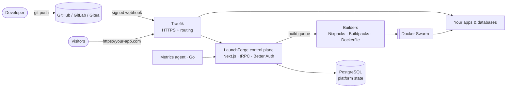

<div align="center">

# LaunchForge OS

**Push to Git. Ship to production. On servers you own.**

A self-hosted Platform-as-a-Service: connect a repository, push, and LaunchForge builds it into a container, runs it behind HTTPS on your domain, and gives you logs, metrics, databases, backups and rollbacks from one dashboard.

[](https://github.com/Aayushajs/LaunchForge-OS/actions/workflows/ci.yml)
[](LICENSE)

</div>

## Features

| Area | What you get |
|---|---|
| **Git deployments** | GitHub App, GitLab, Gitea, Bitbucket or any Git URL. Auto-deploy on push, watch paths, tag triggers, PR preview environments |
| **Any stack** | Nixpacks, Railpack, Heroku and Paketo buildpacks, Dockerfile or static sites: Node.js, NestJS, Next.js, React, Python, PHP, Go, Java and more |
| **Isolated runtime** | Every app runs as a Docker Swarm service with CPU/memory limits, replicas and start-first rolling updates |
| **Managed databases** | PostgreSQL, MySQL, MariaDB, MongoDB, Redis and libSQL with scheduled S3 backups and one-click restore |
| **Domains & HTTPS** | Custom domains with automatic Let's Encrypt certificates through Traefik |
| **Observability** | Host and container metrics, live logs, web terminal, alerts to Slack, Discord, Telegram, email and more |
| **Teams & access** | Organizations, owner/admin/member roles, custom roles with fine-grained permissions, API keys, 2FA and passkeys |
| **Audit trail** | Every change recorded: who did what, to which resource, and when |
| **Multi-server** | Add servers over SSH, dedicated build servers, Docker Swarm clusters |
| **API** | Full REST/OpenAPI surface for automation |

## Architecture



Design documents live in [`docs/`](docs): project overview, repository audit, gap analysis, dependency map and licensing notes, followed by HLD/LLD, ER diagrams, API contracts, threat model and load-test reports as they are completed.

## Tech stack

TypeScript monorepo (pnpm workspaces) · Next.js 16 · React 19 · tRPC 11 · Tailwind 4 · PostgreSQL 16 · Drizzle ORM · Better Auth · Dockerode · Docker Swarm · Traefik v3 · Go (metrics agent) · Vitest · GitHub Actions

## Getting started (development)

Requirements: Node.js 24 (see `.nvmrc`), pnpm 10, Docker with Swarm mode.

```bash
pnpm install
cp apps/dokploy/.env.example apps/dokploy/.env
pnpm run dokploy:setup     # Swarm, network, Traefik and Postgres containers
pnpm run server:script     # build the shared server package in watch mode
pnpm run dokploy:dev       # http://localhost:3000
```

Useful commands:

| Command | Purpose |
|---|---|
| `pnpm typecheck` | Type-check every workspace |
| `pnpm test` | Run the Vitest suite |
| `pnpm check` | Format and lint with Biome |
| `pnpm --filter=dokploy run reset-password` | Reset the admin password |

## Production install

On a fresh Ubuntu 22.04/24.04 or Debian 12 server (2 GB RAM, 20 GB disk, ports 80/443/3000 free):

```bash
curl -fsSL https://raw.githubusercontent.com/Aayushajs/LaunchForge-OS/main/scripts/install.sh | sudo bash
```

The installer checks the server, installs Docker, initializes Swarm, generates all secrets as Docker secrets, starts PostgreSQL, Traefik and the dashboard, and waits until it is healthy. Then open `http://<server-ip>:3000` and create the owner account.

```bash
sudo bash install.sh upgrade              # backs up the database, upgrades, rolls back if unhealthy
sudo bash install.sh status
sudo bash install.sh uninstall [--purge]
```

Images are published to GitHub Container Registry (`ghcr.io/aayushajs/launchforge`). See [docs/09-release](docs/09-release) for configuration, upgrades, backups and operations.

## Roadmap

- [x] Repository audit, gap analysis and licensing review
- [x] Apache-2.0-only codebase with built-in audit logging and custom roles
- [x] One-command installer with upgrade and rollback
- [x] Workspace isolation: mount/compose policy, container hardening
- [ ] Per-workspace overlay networks
- [x] Resource quotas and per-workspace usage metering
- [x] Health-gated deployments, signed webhooks, durable queue
- [ ] Registry-free rollback
- [x] Cross-workspace domain ownership
- [ ] DNS TXT domain verification and platform wildcard domains
- [ ] Load-test reports (k6)

## License

[Apache License 2.0](LICENSE). See [NOTICE](NOTICE) for attributions.
