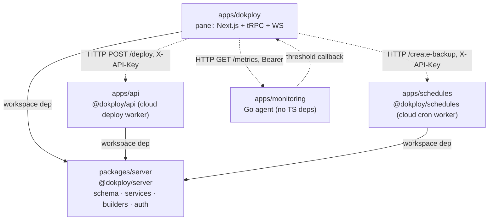

# Dependency Map

> Baseline: Dokploy `canary` @ `d73650694` · Date: 2026-11-07
> Sources: `package.json` files, `pnpm-workspace.yaml`, `apps/monitoring/go.mod`, Dockerfiles, `packages/server/src/setup/*`.

## 1. Workspace packages

| Package | Version | License field | Role |
|---|---|---|---|
| `apps/dokploy` (`dokploy`) | v0.31.0 | Apache-2.0 | The product: UI, API, websockets, self-hosted queue and crons |
| `packages/server` (`@dokploy/server`) | 1.0.0 | — (repo licence applies) | Shared core imported by all TS apps |
| `apps/api` (`@dokploy/api`) | 0.0.1 | — | Cloud-mode deployment worker (Inngest) |
| `apps/schedules` (`@dokploy/schedules`) | — | — | Cloud-mode cron worker (BullMQ) |
| `apps/monitoring` | — | own `LICENSE.md` | Metrics agent (Go 1.24) |

**LaunchForge relevance:** Phase A (self-hosted) needs only `apps/dokploy`, `packages/server` and `apps/monitoring`. `apps/api` and `apps/schedules` are cloud-mode only and can stay dormant until Phase B, or be reused if a durable queue is adopted (GAP A6).

## 2. Toolchain

| Tool | Version | Source |
|---|---|---|
| Node.js | 24.22.1 (`.nvmrc`, `engines: ^24.22.1`) | root |
| pnpm | 10.22.0 (`packageManager`) | root |
| TypeScript | workspace devDep | apps |
| Biome | 2.5.7 (lint + format) | root |
| esbuild / tsx | 0.25.0 / 4.22.4 | root |
| Vitest | devDep of `apps/dokploy` | tests |
| drizzle-kit | devDep | migrations |
| Go | 1.24 | monitoring |

`pnpm.overrides` pins ~40 transitive packages for security fixes; keep them when merging upstream.

## 3. Key runtime libraries

| Concern | Library | Version | Used in |
|---|---|---|---|
| Web framework | next | 16.4.1 | dokploy |
| UI | react / react-dom | 19.2.7 | dokploy |
| UI kit | radix-ui, shadcn, tailwindcss 4, lucide-react, recharts | — | dokploy |
| API | @trpc/server, @trpc/client, @trpc/react-query | ^11.10 | dokploy, server |
| OpenAPI | @dokploy/trpc-openapi (Dokploy fork), swagger-ui-react | — | dokploy |
| Validation | zod | ^4.6 | all |
| ORM / DB driver | drizzle-orm 0.45.2, postgres (postgres.js) | — | dokploy, server |
| Auth | better-auth 1.6.23 + @better-auth/{api-key, passkey, sso, scim} | — | server |
| Docker | dockerode 4.0.2 | — | server |
| SSH | ssh2, node-pty | — | server |
| Git hosting | octokit, @octokit/auth-app, @octokit/webhooks | — | server, dokploy |
| Billing | stripe 17.2.0, @stripe/stripe-js | — | dokploy |
| Email | nodemailer, resend, @react-email/components | — | server |
| Scheduling | node-schedule (self-hosted), bullmq + ioredis (schedules), inngest (api) | — | various |
| HTTP (workers) | hono, @hono/node-server | — | api, schedules |
| AI assistant | ai (Vercel AI SDK) + providers (OpenAI, Anthropic, Azure, Mistral, Cohere, DeepInfra, Ollama) | — | server |
| Cloud integrations | @aws-sdk (CloudWatch, Route 53, Secrets Manager, SSM) | — | server |
| Analytics | posthog-js, @openpanel/nextjs | — | dokploy (cloud) |
| Monitoring agent | gofiber/fiber v2, gopsutil v3, go-sqlite3, robfig/cron | — | monitoring |

**Review items for LaunchForge:** third-party analytics (PostHog, OpenPanel, HubSpot signup tracking in cloud mode) should be removed or opt-in for a self-hosted product.

## 4. Runtime services (self-hosted install)

| Service | Image / binary | How created | Persistent data |
|---|---|---|---|
| Panel | `dokploy/dokploy` (built from `Dockerfile`) | Swarm service `dokploy` | `/etc/dokploy` (configs, logs, Traefik dynamic files) |
| Control-plane DB | `postgres:16` | Swarm service `dokploy-postgres` (`setup/postgres-setup.ts`) | named volume |
| Reverse proxy | `traefik:v3.7.16` (env `TRAEFIK_VERSION`) | standalone container `dokploy-traefik` (`setup/traefik-setup.ts`) | `/etc/dokploy/traefik` incl. `acme.json` |
| Metrics agent | `dokploy/monitoring` | Swarm service `dokploy-monitoring` (`setup/monitoring-setup.ts`) | `/etc/dokploy/monitoring/monitoring.db` |
| Log shipping (optional) | `timberio/vector:0.58.0-alpine`, `ghcr.io/google/cadvisor:v0.60.6` | `setup/vector-setup.ts` | — |
| Overlay network | `dokploy-network` | `initializeNetwork` | — |

No Redis is needed for self-hosted mode today; the deploy queue is in-memory.

**Binaries baked into the panel image (`Dockerfile`):** Docker CLI 29.9.3, rclone, Nixpacks 1.41.0, Railpack 0.15.4, `pack` 0.39.1, tini, git-lfs. Remote servers get Docker 29.9.3 (newest available on older distros) + builders via `setup/server-setup.ts`.

## 5. External network dependencies

| Endpoint | Purpose | Needed for LaunchForge? |
|---|---|---|
| `https://templates.dokploy.com` | One-click template catalog | Replace with own/bundled catalog (or keep with attribution) |
| `https://licenses-api.dokploy.com` | Enterprise licence validation (proprietary) | **Remove** |
| `https://dokploy.com/install.sh` | Installer (not in repo) | **Replace** with in-repo installer |
| Docker Hub tags API | Update checks (`services/settings.ts:51`) | Point to LaunchForge images |
| `https://railpack.com/install.sh` | Installed during Railpack builds | Pin and vendor the binary instead |
| `sslip.io` | Generated hostnames | Replace with platform wildcard domain |
| Let's Encrypt ACME | TLS certificates | Keep |
| GitHub/GitLab/Gitea/Bitbucket APIs | Source providers | Keep |
| Stripe, HubSpot, PostHog, OpenPanel | Cloud billing/analytics | Phase B only / remove |

## 6. Configuration surface (environment variables)

| Variable | Purpose |
|---|---|
| `IS_CLOUD` | Switches cloud vs self-hosted behaviour across the codebase |
| `DATABASE_URL`, `POSTGRES_PASSWORD_FILE` | Control-plane DB (falls back to a hardcoded password if both unset) |
| `BETTER_AUTH_SECRET` | Session signing; also the fallback encryption key |
| `ENCRYPTION_KEY`, `ENCRYPTION_KEY_FILE` | AES-256-GCM key for `encryptedText` columns |
| `SMTP_SERVER`, `SMTP_PORT`, `SMTP_USERNAME`, `SMTP_PASSWORD`, `SMTP_FROM_ADDRESS` | Auth emails |
| `USER_ADMIN_ID` | Cloud root user |
| `SERVER_URL`, `JOBS_URL`, `API_KEY`, `REDIS_URL` | Cloud worker wiring |
| `STRIPE_*`, `NEXT_PUBLIC_STRIPE_PUBLISHABLE_KEY` | Billing |
| `TRAEFIK_VERSION` | Proxy version override |

## 7. Internal module dependencies worth knowing

- **Proprietary coupling:** core files import from `/proprietary` — `packages/server/src/lib/auth.ts`, `services/permission.ts`, `services/server.ts`, `services/git-provider.ts`, `packages/server/src/index.ts`, `apps/dokploy/server/api/trpc.ts`, `root.ts`, `api/utils/audit.ts` (used by ~47 routers), `server/utils/billing.ts`, several pages. See [LICENSE_AUDIT.md](LICENSE_AUDIT.md) and GAP A2.
- **Docker access:** all Docker calls go through `getRemoteDocker(serverId)` (`packages/server/src/utils/servers/remote-docker.ts`) and shell execution through `execAsync` / `execAsyncRemote` (`utils/process/execAsync.ts`). These are the two choke points where isolation policy (GAP A4) can be enforced.
- **Container labels:** `buildDokployLabels` (`utils/docker/dokploy-labels.ts`) tags apps, compose and databases with `dokploy.organization.id`, `project.id`, etc. Usage metering (GAP A5) can aggregate on these labels.
- **Traefik config writes:** `utils/traefik/domain.ts` (file provider) and `utils/docker/domain.ts` (compose labels). These are the two places domain policy (GAP A7) must be enforced.
