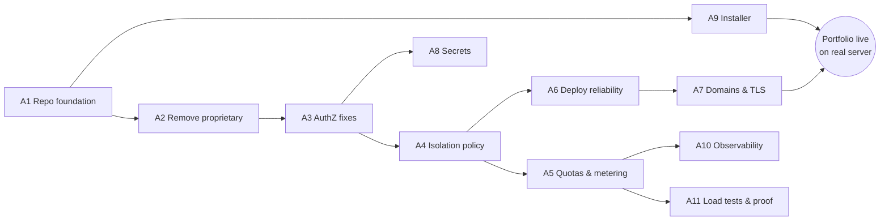

# Gap Analysis — Dokploy → LaunchForge

> Inputs: [REPO_AUDIT.md](REPO_AUDIT.md), [EXISTING_FEATURES.md](EXISTING_FEATURES.md), [LICENSE_AUDIT.md](LICENSE_AUDIT.md) · Date: 2026-11-07
> Scope decision (2026-11-07): **Phase A** self-hosted platform first; **Phase B** hosted-SaaS capabilities later, after licensing is cleared.

## 1. Classification

Each gap is classified as:

- **Reuse** — keep as is; only rebrand or document.
- **Harden** — exists, but unsafe when several workspaces share a host.
- **Extend** — exists, needs new capability.
- **Build** — not present; new LaunchForge module.
- **Replace** — depends on proprietary code; re-implement under Apache-2.0.

Priority: **P0** blocks the first real release · **P1** required for the "multi-tenant PaaS" claim · **P2** polish or later.

## 2. Tenancy model (proposed)

| Concept | Maps to | Notes |
|---|---|---|
| Platform operator | The instance owner (first user) | Can see all workspaces, set quotas, suspend |
| Workspace (tenant) | Existing `organization` | Already the unit of ownership for projects, servers, providers |
| Workspace member | Existing `member` + role | Keep owner/admin/member; add LaunchForge custom roles later |
| Project → Environment → Service | Existing tables | No schema change needed for ownership |

Reusing `organization` as the workspace avoids a data migration. The weakness is that services don't carry `organizationId`; every check must join `environment → project`. Decision on denormalising `organizationId` onto service tables is deferred to the database design phase (G5).

## 3. Phase A — Self-hosted platform

### A1. Repository foundation — P0

| Gap | Type | Work |
|---|---|---|
| Nested accidental clone `./LaunchForge/` | Cleanup | Delete before the first commit |
| Upstream remote is `Dokploy/dokploy` | Build | Create the LaunchForge GitHub repo; keep Dokploy as the `upstream` remote for security fixes |
| Images and pipelines publish to `dokploy/*`, `siumauricio/*` | Extend | Own image names (GHCR), own release workflow; drop the external OpenAPI/CLI/SDK sync jobs |
| Branding (name, logo, emails, `app.dokploy.com` URLs) | Extend | Rebrand UI and emails; replace the hardcoded invite URLs (`routers/organization.ts:393`, `services/admin.ts:109`) with the instance URL; keep Apache-2.0 attribution (see license audit) |
| Proprietary modules wired into core | Replace | See A2 |

### A2. Remove the proprietary dependency — P0

The `/proprietary` code is under a source-available license that requires a commercial agreement for production use. LaunchForge should ship without it.

| Proprietary piece | Used by | LaunchForge replacement |
|---|---|---|
| `hasValidLicense()` | `trpc.ts` (`enterpriseProcedure`), `services/permission.ts`, `services/server.ts`, `services/git-provider.ts`, 4 routers | Remove licence gates; features are either always on (LaunchForge-owned) or removed |
| `createAuditLog` / audit-log router & UI | `auth.ts`, `api/utils/audit.ts` (47 router files) | **Build** a LaunchForge audit-log service on the existing Apache-2.0 `audit_log` table, always on, with retention and export |
| Custom roles | `services/permission.ts` `resolveRole` | **Build** LaunchForge custom roles on the existing `organization_role` table (P1) |
| `resolveOrganizationDefaultRole` | `auth.ts` | Re-implement (small) |
| GitHub/Google sign-in buttons, signup panel | `pages/index.tsx`, `pages/register.tsx` | Re-implement buttons (server-side social providers are Apache-2.0) |
| SSO/SCIM/forward-auth, white-labeling, license-key | `root.ts`, settings pages, `_document.tsx` | Remove from LaunchForge (re-implement later only if needed) |

Verification: a CI check that fails if any non-proprietary file imports from a `proprietary/` path; full test suite green with the folders deleted.

### A3. Authorization fixes — P0

| Gap | Location | Fix |
|---|---|---|
| `move` doesn't validate the target environment's org | `routers/application.ts:1002`, `compose.ts:780`, 6 DB routers | Assert target environment belongs to the active org and the caller can create there |
| `project.duplicate` clones foreign services | `routers/project.ts:840-1272` | Check every source service with `checkServiceAccess` |
| `application.update` accepts foreign IDs | `schema/application.ts:549` | Allow-list updatable fields; validate every foreign key against the active org |
| SSRF in metrics and templates | `routers/server.ts:612`, `routers/user.ts:663`, `routers/compose.ts` | Derive monitoring URLs server-side; restrict template sources; block private ranges for outbound webhooks |
| Domain procedures without checks (`preview`, no-ID paths) | `routers/domain.ts:36-50` | Enforce access for every `domainType` |
| API keys of removed members | `auth.ts:610-658` | Reject keys when no member row exists |
| Impersonation consent client-side only | `impersonation-bar.tsx` | Enforce `allowImpersonation` in a server hook |

Verification: extend `__test__/permissions/` with one negative cross-workspace test per procedure that takes a foreign ID, generated from the router list so new procedures can't skip it.

### A4. Workload isolation & policy — P0 (P1 for advanced items)

| Gap | Type | Work |
|---|---|---|
| Arbitrary host bind mounts | Harden | Policy: bind mounts only for the platform operator, or only under an allow-listed base path; always block `docker.sock`, `/`, `/etc`, `/proc`, `/var/lib/docker` |
| Unvalidated compose | Harden | Compose policy validator: reject `privileged`, `cap_add`, host network/PID/IPC, device and socket mounts, foreign Traefik router labels; operator can relax per workspace |
| Raw Swarm JSON (placement, networks, endpoint) | Harden | Validate against the workspace's own networks and allowed node labels |
| Shared `dokploy-network` | Harden | Per-workspace overlay network; Traefik joins each; inter-workspace traffic blocked by default |
| No container hardening | Build | Default `CapDrop: ALL` + minimal `CapAdd`, `PidsLimit`, `no-new-privileges`, optional read-only rootfs |
| Builds on host daemon, no limits/timeouts | Harden | Build CPU/memory limits, build timeout, per-build cancel (replace `pkill -f`), per-build temp SSH key files |
| Local-daemon fallback for remote servers | Harden | Fail closed when a server has no SSH key; require `serverId` in cluster procedures |

Verification: security test suite that attempts each escape (socket mount, privileged compose, host network, foreign network attach) and expects rejection.

### A5. Resource quotas & metering — P1 (the main original engineering piece)

| Gap | Type | Work |
|---|---|---|
| No per-workspace limits | Build | `workspace_quota`: max CPU, memory, disk, services, databases, concurrent builds, build minutes/month, domains |
| Limits optional per service | Extend | Every service gets defaults; sum of limits validated against the workspace quota at create/update/scale |
| No usage data per workspace | Build | Usage collector: aggregate container metrics by `dokploy.organization.id` label into time-series rollups (hourly/daily) |
| No usage UI | Build | Workspace usage page; operator overview of all workspaces |
| Disk usage | Build | Volume size accounting (`docker system df -v`) and enforcement policy |

### A6. Deployment reliability — P1

| Gap | Type | Work |
|---|---|---|
| Health checks only if user writes Swarm JSON | Extend | First-class health check config (HTTP path / TCP / command) with sensible defaults per build type |
| "Done" declared before the container is healthy | Extend | Health-gated deploy: wait for tasks to reach running + healthy, else auto-rollback and mark failed |
| Rollback requires a registry | Extend | Local image retention (`app:deploy-<id>`) for one-click rollback without a registry; strip credentials from rollback snapshots |
| In-memory queue lost on restart | Harden | Durable queue (Postgres-backed jobs table, or BullMQ with Redis added to the stack); resume/mark interrupted deploys on boot |
| Deploy webhooks without signatures | Harden | HMAC/secret-token checks for GitLab, Gitea, Bitbucket; raw-body GitHub verification; POST only; rate limit |
| Only last 10 deployments kept | Extend | Configurable retention |

### A7. Domains & TLS — P1

| Gap | Type | Work |
|---|---|---|
| No host uniqueness | Harden | Unique index on normalised host (+ path) across the instance |
| No ownership verification | Build | TXT-record (or HTTP token) verification before a custom domain goes live; platform subdomains skip it |
| `sslip.io` generated hosts | Extend | Platform wildcard domain (`*.apps.<instance-domain>`) configured at install |
| No wildcard certs | Build | DNS-01 via the existing DNS-provider integrations |

### A8. Secrets — P1

Encrypt at rest with the existing `encryptedText` column type: DB passwords, SSH private keys, Git provider tokens/secrets, registry passwords, S3 keys, certificate private keys, notification tokens. Make decryption failures raise errors instead of returning ciphertext. Replace `Math.random` password generation with `crypto.randomBytes`. Require `ENCRYPTION_KEY`; document key rotation.

### A9. Installer & operations — P0

| Gap | Type | Work |
|---|---|---|
| Installer not in repo | Build | `scripts/install.sh` in-repo: OS/arch/port/RAM pre-checks, Docker install, Swarm init, secrets generation (no hardcoded Postgres password), Traefik, platform domain + email prompts or flags, idempotent re-runs |
| Upgrades | Extend | `launchforge upgrade` with pre-upgrade backup, migration, health check and automatic rollback |
| Uninstall / backup / restore runbooks | Build | Scripted + documented |
| CI coverage | Build | Installer test on Ubuntu 22.04/24.04 and Debian 12 VMs in CI; upgrade test from the previous release |
| SSH host-key verification | Harden | Pin host keys on server add |

### A10. Observability — P1/P2

Per-workspace metrics views (from A5); log retention policy; replace user-supplied metrics URLs (SSRF); platform health page; optional Prometheus `/metrics` endpoint for the control plane itself.

### A11. Quality & proof — P1 (continuous)

- Tests for every change; packages without tests today (`packages/server`, `apps/monitoring`) get tests where we change code.
- Language matrix: one sample app per language (Node, NestJS, Next.js, React SPA, Python, PHP, Go, Java), deployed in CI as a smoke test.
- k6 load tests: API p50/p95/p99, concurrent deployments, webhook bursts. Reports only from real runs.
- **First production workload: the author's portfolio**, deployed by Git push with a custom domain and HTTPS.

## 4. Phase B — Hosted SaaS capabilities (blocked on licensing)

| Gap | Type | Notes |
|---|---|---|
| Public signup on a shared host | Extend | Exists in cloud mode, but cloud mode assumes tenant-owned servers; needs the A3–A5 work plus abuse controls (email verification, captcha, signup rate limits) |
| Plans tied to quotas | Extend | Rework `plan-limits.ts` from server-count to quota-based plans |
| Usage-based billing | Build | Billing from A5 metering; move billing fields from `user` to `organization`; idempotent Stripe webhook handling |
| Platform admin console | Build | Workspaces list, usage, suspension (`banned` fields exist), audit trail |
| Abuse detection | Build | Crypto-mining/egress heuristics from metrics |
| Isolation upgrade | Build | Optional gVisor/Kata runtime or dedicated build workers |

**Gate:** Phase B must not be offered commercially until the questions in [LICENSE_AUDIT.md §5](LICENSE_AUDIT.md#5-open-questions-to-resolve-before-phase-b) are answered in writing.

## 5. Dashboard decision — recommendation

**Recommendation: extend and rebrand the existing Dokploy dashboard. Don't build a separate frontend.**

The earlier plan suggested a fresh Render-style frontend. After the audit, that is the worse trade-off for Phase A:

- The existing UI already covers every engine feature (≈550 API procedures). A new frontend would spend months re-implementing screens instead of building the parts that are new engineering (isolation, quotas, reliability, installer).
- A self-hosted product has one audience, the workspace owner. That is the audience the current UI already serves.
- New LaunchForge screens (usage and quotas, operator console, domain verification, health-check config) fit into the existing Next.js app and design system.

A distinct customer-facing frontend can be reconsidered for Phase B.

## 6. Suggested implementation order

A9 (installer) can run in parallel with A2–A4, because it touches setup scripts, not routers.

## 7. Where the original engineering lives

Forking alone is not the achievement. What is new in LaunchForge:

1. Workspace isolation layer: compose/mount/Swarm policy engine, per-workspace networks, container hardening (A4).
2. Quota engine and usage metering pipeline (A5).
3. Health-gated deployments with automatic, registry-free rollback and a durable job queue (A6).
4. Domain ownership verification and platform wildcard domains (A7).
5. Production installer with upgrade and rollback, tested across distributions in CI (A9).
6. Systematic cross-tenant authorization test harness (A3).
7. Apache-2.0 re-implementations of audit logging and custom roles (A2).
