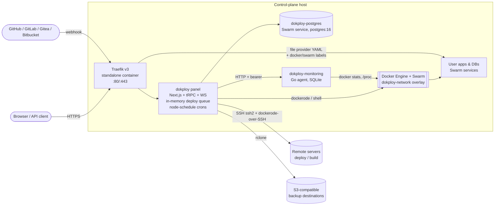
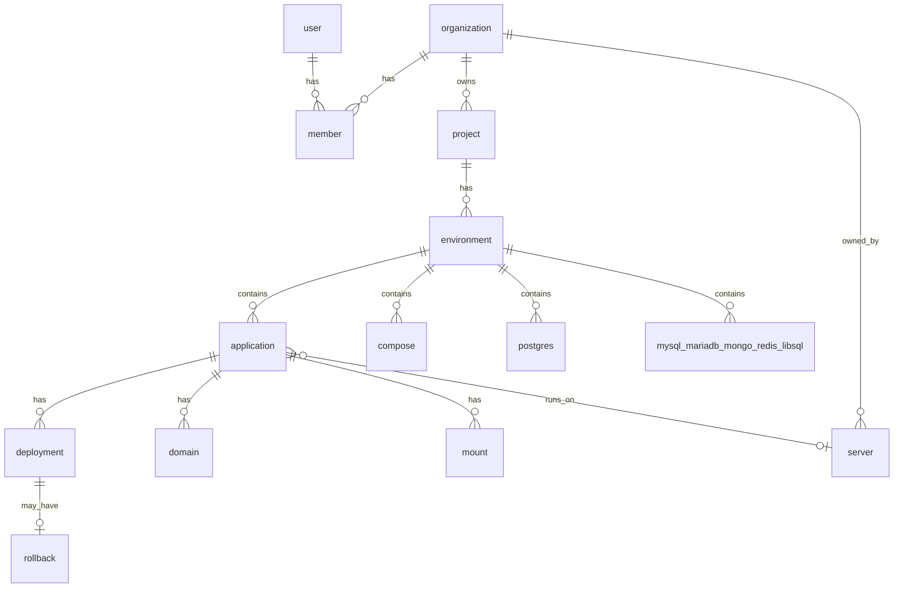

# Repository Audit — Dokploy baseline

> Baseline: `canary` @ `d73650694` · App version `v0.31.0` · Audit date: 2026-11-07
> Method: read-only source inspection. Every claim below was checked against source code, not README text. Items that could not be confirmed are marked **UNVERIFIED**. Paths are relative to the repository root.

## 1. Executive summary

Dokploy is a complete self-hosted PaaS. Its deployment engine (Git → build → Docker Swarm service → Traefik route) is solid and well tested for command-injection regressions. It also has a "cloud mode" (`IS_CLOUD=true`) with self-signup, organizations and Stripe billing.

What Dokploy is **not** is a shared-host multi-tenant platform. In cloud mode every tenant must bring their own server (`apps/dokploy/server/api/routers/application.ts:93-102` rejects resources without a `serverId`), so tenant isolation on a shared host was never a design goal. Running several untrusted workspaces on one LaunchForge host therefore needs new work: container hardening, mount/compose policy, network isolation, quotas, and fixes to several cross-organization authorization holes.

Three findings shape the whole plan:

1. **Container escape surface.** Users can bind-mount any host path (including `/var/run/docker.sock`) and deploy unvalidated compose files with `privileged`, `network_mode: host`, etc. On a single-owner install that is a feature; on a shared host it is root on the machine.
2. **Cross-tenant authorization gaps.** `move` procedures, `project.duplicate` and `application.update` accept foreign IDs without an ownership check (details in §6).
3. **Load-bearing proprietary code.** `hasValidLicense()` from a `/proprietary` folder (source-available license, not Apache-2.0) is called from the core permission engine and tRPC middleware; audit logging is silently disabled without a Dokploy license.

## 2. Repository structure

```text
apps/
  dokploy/      Next.js dashboard + tRPC API + custom Node server (websockets, queue, crons)   ~800 TS files
  api/          Hono + Inngest deployment worker (cloud mode only)                             5 TS files
  schedules/    Hono + BullMQ/Redis cron worker (cloud mode only)                               6 TS files
  monitoring/   Go (Fiber + SQLite) host/container metrics agent                              11 Go files
packages/
  server/       @dokploy/server — DB schema, services, builders, Docker/Traefik utils, auth  ~300 TS files
Dockerfile*     panel, cloud panel, api worker, schedules worker, monitoring agent
.github/        10 workflows (build/test/typecheck, image publishing, OpenAPI sync, hotfixes)
openapi.json    generated REST spec (~554 paths)
```

> The working tree also contains `./LaunchForge/`, an accidental second clone of the same repository. It is not part of the codebase and was excluded from this audit.

## 3. Runtime architecture (as-is, self-hosted mode)



In cloud mode the panel instead forwards deploys to `apps/api` (Inngest, concurrency 1 per server) and crons to `apps/schedules` (BullMQ), and resources must live on tenant-owned remote servers.

## 4. Module audit

Status legend: **Implemented** = works end to end in source · **Partial** = exists with material gaps · **Missing** = not present.

### 4.1 Authentication — Implemented
- **Where:** `packages/server/src/lib/auth.ts` (`createBetterAuth` L71, `validateRequest` L576); handler `apps/dokploy/pages/api/auth/[...all].ts`.
- **How:** Better Auth 1.6.23 with plugins `apiKey`, `organization` (+ dynamic access control), `twoFactor`, `passkey`, `sso`, `scim`, `admin`. Sessions last 3 days (refresh after 1). bcrypt cost 10.
- **Signup:** self-hosted: the first user becomes owner; later users only via invitation token (`x-dokploy-token`), SSO or SCIM. Cloud: public email/GitHub/Google signup, each user gets their own org.
- **Email:** verification required only when `IS_CLOUD` and production; password reset via SMTP env vars (`packages/server/src/verification/send-verification-email.tsx`).
- **Gaps:** no 2FA enforcement policy; self-hosted cookies `secure: false`; invite URLs hardcode `https://app.dokploy.com` (`routers/organization.ts:393`, `services/admin.ts:109`); no signup abuse controls.

### 4.2 Organizations, roles, permissions — Implemented with gaps
- **Schema:** `packages/server/src/db/schema/account.ts` — `organization`, `member` (role + access lists `accessedProjects/Environments/Services/GitProviders/Servers`), `invitation`, `organization_role`, `apikey`.
- **Roles:** `packages/server/src/lib/access-control.ts` — static `owner`, `admin`, `member`. Custom roles resolve only with a Dokploy license (`services/permission.ts:52-87`).
- **Enforcement:** tRPC middlewares in `apps/dokploy/server/api/trpc.ts` — `protectedProcedure` (L164), `adminProcedure` (L196), `enterpriseProcedure` (L219, license-gated), `withPermission` (L261). Service ownership via `assertServiceInOrganization` (joins service → environment → project → `organizationId`) in `checkServiceAccess` / `checkServicePermissionAndAccess` (`services/permission.ts:339-394`).
- **Tests:** `apps/dokploy/__test__/permissions/` includes `cross-org-scope` and `service-access` suites.
- **Gaps:** see §6.

### 4.3 API & API keys — Partial
- **REST:** `apps/dokploy/pages/api/[...trpc].ts` exposes tRPC via `@dokploy/trpc-openapi`; spec generated by `apps/dokploy/scripts/generate-openapi.ts` → `openapi.json`.
- **Auth:** `x-api-key` header (Better Auth `apiKey` plugin); key metadata carries `organizationId`.
- **Gaps:** no scopes (the `permissions` column is unused); `canAccessToAPI` enforced only in the UI; no app-level rate limiting; no API versioning; API keys of removed members still produce a session with role defaulted to `member` (`auth.ts:610-658`).

### 4.4 Git providers & webhooks — Implemented, partially secured
- **Providers:** GitHub App created per org via manifest flow (`pages/api/providers/github/setup.ts`, `utils/providers/github.ts`); GitLab and Gitea OAuth per org; Bitbucket app password/API token; raw Git over HTTPS/SSH (`utils/providers/git.ts`).
- **Webhooks:**
  - `pages/api/deploy/github.ts` — verifies `X-Hub-Signature-256` (but over `JSON.stringify(req.body)`, not the raw body).
  - `pages/api/deploy/[refreshToken].ts` and `deploy/compose/[refreshToken].ts` — authenticated **only** by a secret token in the URL; no GitLab/Gitea/Bitbucket signature checks; any HTTP method (including GET) triggers a deploy.
- **Filters:** branch, tag trigger, `watchPaths`, `[skip ci]`; GitHub PRs create preview deployments (with collaborator permission check and `previewLimit`).
- **Gaps:** provider secrets/tokens stored in plaintext; OAuth callbacks for GitLab/Gitea lack session checks and state nonces; SSH deploy keys written to a fixed `/tmp/id_rsa` (`utils/providers/git.ts:48,84`), never deleted and shared across concurrent builds.

### 4.5 Deployment pipeline — Implemented
- **Queue:** self-hosted uses a process-local FIFO queue (`apps/dokploy/server/queues/in-memory-queue.ts`), partitioned per server, serial per app, `buildsConcurrency` 1–100 (`concurrency.ts`). **Jobs are lost on restart.** Cloud mode uses Inngest in `apps/api`.
- **Flow (`packages/server/src/services/application.ts:178-284`, `deployApplication`):** create `deployment` row + log file → build one `set -e` shell script (clone → apply patches → build → optional registry push) → run locally (`execAsync`) or over SSH (`execAsyncRemote`) → `mechanizeDockerContainer` (`utils/builders/index.ts:83-245`) updates or creates the Swarm service → mark `done`/`error` → notify.
- **Cancel:** `killDockerBuild` runs `pkill -2 -f "docker build"` — kills **every** build on that host.
- **Gaps:** non-durable queue; no build timeout; "done" is declared 3 s after scheduling, not after the container is healthy.

### 4.6 Build systems — Implemented
`buildType` enum (`schema/application.ts:70-77`): `nixpacks` (default), `railpack`, `heroku_buildpacks`, `paketo_buildpacks`, `dockerfile`, `static`. Builders in `packages/server/src/utils/builders/`. Extra sources: prebuilt `docker` image and `drop` (zip upload). Language coverage comes from the upstream builders; there is no in-repo language matrix or sample apps. Railpack is installed with `curl … | sh` on each build.

### 4.7 Container runtime — Partial (single-owner security model)
- Applications always run as Swarm services; compose apps run as `docker compose up` or `docker stack deploy` (`utils/builders/compose.ts`).
- **Resource limits:** `memoryLimit`, `cpuLimit`, reservations (free-text) → `calculateResources` (`utils/docker/utils.ts:624-642`). Default: unlimited. Builds are never limited.
- **Updates:** default `UpdateConfig {Order: "start-first", FailureAction: "rollback"}` (`utils/docker/utils.ts:696-714`) → zero-downtime only if a health check exists; health checks are set only if the user supplies `healthCheckSwarm`.
- **Isolation gaps (all verified):**
  - Arbitrary host bind mounts: `generateBindMounts` passes `hostPath` straight through (`utils/docker/utils.ts:738-750`).
  - Compose files are not policy-checked (privileged, `docker.sock`, host network/PID, `cap_add`).
  - Every app joins the shared `dokploy-network` overlay by default (`services/network.ts:363-388`), which Traefik and other tenants' apps also use.
  - Users can supply raw Swarm JSON (`placementSwarm`, `networkSwarm`, `endpointSpecSwarm`, …) unchecked.
  - No `CapDrop`, `PidsLimit`, read-only rootfs, user namespaces or seccomp profiles anywhere.

### 4.8 Deployment management — Partial
- **History:** `deployment` table; only the last 10 per app are kept (`services/deployment.ts:696-710`). Build logs are files under `/etc/dokploy/logs/<appName>/`.
- **Rollback:** works only with a configured rollback registry (`services/rollbacks.ts`, `utils/cluster/upload.ts:52-75`); stores a `fullContext` JSON snapshot including registry credentials in plaintext.
- **Preview deployments:** GitHub PRs only (`services/preview-deployment.ts`).

### 4.9 Managed databases — Implemented
- Engines: Postgres, MySQL, MariaDB, MongoDB, Redis, libSQL (`packages/server/src/utils/databases/*.ts`), each a Swarm service with a named data volume.
- External access via host-mode published ports; only a collision check (`services/settings.ts:455`).
- **Gaps:** `databasePassword`/`rootPassword` stored as plaintext `text`; server-side `generatePassword` uses `Math.random()` (`packages/server/src/templates/index.ts:59`); no storage quotas; `rebuildDatabase` deletes the data volume.

### 4.10 Backups & restore — Implemented
- DB dumps streamed with `rclone` to S3-compatible destinations (`packages/server/src/utils/backups/`), retention by count; volume backups via a tar sidecar (`utils/volume-backups/`); streaming restore as a tRPC subscription (`routers/backup.ts:589`).
- Schedules: in-process `node-schedule` (self-hosted) or `apps/schedules` (cloud).
- **Gaps:** destination credentials in plaintext; no Redis dump backup; no backup encryption; no restore verification.

### 4.11 Domains, routing & TLS — Implemented, ownership gap
- Traefik v3 standalone container (`packages/server/src/setup/traefik-setup.ts`) with file, docker and swarm providers. Apps get per-app YAML routers (`utils/traefik/domain.ts`); compose apps get injected labels (`utils/docker/domain.ts`).
- TLS: Let's Encrypt HTTP-01 resolver; custom certificates (private key stored in plaintext).
- Generated hostnames use `sslip.io`.
- **Gaps (verified):** `domain.host` has no unique constraint (`schema/domain.ts:31`) and `createDomain` does no duplicate or ownership check — any workspace can route any hostname, including one already in use. Compose files can also declare raw Traefik router labels. No DNS-01/wildcard support (**UNVERIFIED** whether the `dnsChallenge` type is wired anywhere).

### 4.12 Monitoring, logs, notifications — Implemented (host-centric)
- Go agent (`apps/monitoring`): host metrics (gopsutil) and container metrics (`docker stats`) into SQLite with retention cleanup; threshold alerts call back into the panel. Bearer-token auth, CORS `*`.
- Live logs/terminal over WebSockets (`apps/dokploy/server/wss/`) with container-ownership checks (`container-ownership.ts`).
- Optional log/metric shipping via Vector + cAdvisor to 9 providers (`services/logs-and-metrics/`).
- Notifications: 12 channels (Slack, Discord, Telegram, email, Teams, ntfy, custom webhook, …).
- **Gaps:** metrics are per host, not per workspace; `server.getServerMetrics` (`routers/server.ts:612`) and `user.getContainerMetrics` (`routers/user.ts:663`) fetch a caller-supplied URL server-side (SSRF), and members can reach the former.

### 4.13 Server management & installation — Implemented (self-hosted)
- Remote servers over SSH (`packages/server/src/setup/server-setup.ts`): installs Docker, Swarm, network, Traefik, builders. Build-only servers supported (`serverType: build`).
- Panel bootstrap: `apps/dokploy/setup.ts` → Swarm init, `dokploy-network`, Traefik, Postgres (falls back to a hardcoded password if `POSTGRES_PASSWORD_FILE` / `DATABASE_URL` are unset — `packages/server/src/db/constants.ts:22-45`).
- **Installer:** not in the repo. README points to `https://dokploy.com/install.sh`; CI downloads it from another repo.
- **Upgrades:** `settings.updateServer` swaps the `dokploy` service image to the latest Docker Hub tag.
- **Gaps:** SSH host keys are never verified (no `hostVerifier`); `getRemoteDocker` silently falls back to the **local** Docker daemon when a server has no SSH key (`utils/servers/remote-docker.ts`), and `server.sshKeyId` is `onDelete: set null`.

### 4.14 Billing — Implemented (cloud only, server-count model)
- `apps/dokploy/server/api/routers/stripe.ts`, webhook `pages/api/stripe/webhook.ts` (raw-body signature verified), plan limits `server/api/utils/plan-limits.ts`.
- Billing state lives on the owner's `user` row (`serversQuantity`, Stripe IDs), not on `organization`. No usage metering.

### 4.15 Audit logging — Implemented but license-gated
`audit_log` table (Apache-2.0 schema) written via `audit()` from ~47 router files, but `createAuditLog` (proprietary) **skips the write unless the org holds a Dokploy enterprise license.** Effectively disabled for LaunchForge.

### 4.16 Platform administration — Partial (cloud only)
Root user via `USER_ADMIN_ID`; impersonation bar (`components/dashboard/impersonation/impersonation-bar.tsx`) — the user's `allowImpersonation` consent is only enforced client-side. `user.banned` columns exist without a suspension flow. No admin dashboard.

### 4.17 Templates — Implemented (remote catalog)
One-click apps fetched from `https://templates.dokploy.com` (`packages/server/src/templates/github.ts`), deployed as compose. `compose.templates`/`deployTemplate` accept a caller-supplied `baseUrl` (another server-side fetch).

## 5. Data model

68 tables in `packages/server/src/db/schema/`. Ownership chain:



- `organizationId` is stored directly on project, server, destination, certificate, registry, network, notification, git_provider, ssh, schedule, ai, audit_log, dns_provider, tag, telemetry, vault and auth tables.
- Services (applications, compose, databases) **do not** carry `organizationId`; tenancy is resolved by joining `environment → project`.
- `webServerSettings` is a global singleton; billing fields live on `user`.
- Migrations: drizzle-kit, 200 SQL files `0000`–`0198` in `apps/dokploy/drizzle/` (number `0130` appears twice), applied at container start by `apps/dokploy/migration.ts`.

The full ER diagram is a Phase G5 deliverable.

## 6. Security findings (prioritised)

Severity reflects the LaunchForge target (several untrusted workspaces on one host). On a single-owner install most "Critical" items are acceptable features.

| # | Severity | Finding | Location |
|---|---|---|---|
| S1 | Critical | Arbitrary host bind mounts (incl. `docker.sock`, `/`) | `utils/docker/utils.ts:738-750`, `services/mount.ts` |
| S2 | Critical | Unvalidated user compose (privileged, host network/PID, socket mounts, raw Traefik labels) | `utils/builders/compose.ts`, `utils/docker/domain.ts` |
| S3 | Critical | `move` procedures don't check the target environment's organization (application, compose, all 6 DB routers) | e.g. `routers/application.ts:1002-1020` |
| S4 | Critical | `project.duplicate` clones services by ID without ownership checks (leaks env vars/DB passwords across orgs) | `routers/project.ts:840-1272` |
| S5 | High | `application.update` accepts any foreign `environmentId`, `registryId`, `githubId`, `customGitSSHKeyId`, … | `schema/application.ts:549-554`, `services/application.ts:147` |
| S6 | High | No domain ownership verification or host uniqueness — route hijacking | `schema/domain.ts:31`, `services/domain.ts:21` |
| S7 | High | Shared `dokploy-network` + user-controlled Swarm networks/placement | `services/network.ts:363-388`, `schema/shared.ts` |
| S8 | High | SSRF via caller-supplied URLs (metrics, templates `baseUrl`, custom webhooks) | `routers/server.ts:612`, `routers/user.ts:663`, `routers/compose.ts` |
| S9 | High | Builds use the host Docker daemon with no limits or timeouts | `utils/builders/*` |
| S10 | High | Remote Docker falls back to the local daemon when a server's SSH key is gone; cluster router acts locally when `serverId` omitted | `utils/servers/remote-docker.ts`, `routers/cluster.ts` |
| S11 | Medium | Generic deploy webhooks: URL token only, no HMAC, accept GET | `pages/api/deploy/[refreshToken].ts` |
| S12 | Medium | Plaintext secrets: DB passwords, SSH keys, provider tokens, S3 keys, cert keys, registry passwords | various `schema/*.ts` |
| S13 | Medium | Shared `/tmp/id_rsa` for SSH clones; `pkill -f "docker build"` cancels all builds | `utils/providers/git.ts:48-85`, `queues/queueSetup.ts` |
| S14 | Medium | SSH host keys not verified | `utils/process/execAsync.ts`, `utils/servers/remote-docker.ts` |
| S15 | Medium | Hardcoded Postgres fallback password | `packages/server/src/db/constants.ts:22-45` |
| S16 | Low | Weak `Math.random` password generator; GitHub webhook signature over re-serialised body; no API rate limiting | `templates/index.ts:59`, `pages/api/deploy/github.ts` |

## 7. Tests & CI

- Vitest; **173 test files** under `apps/dokploy/__test__` (strong on compose/command injection, deploy, traefik, backups, cross-org permissions). The single `.tsx` test is excluded by the config's include glob. No tests in `packages/server`, `apps/api`, `apps/schedules` or the Go agent.
- Workflows: PR build/test/typecheck matrix, Biome formatting, multi-arch image publishing, OpenAPI sync to external CLI/SDK/MCP repos, hotfix automation, manual upgrade integration test. LaunchForge will need its own image registry, release and installer pipelines (current ones push to `dokploy/*` and `siumauricio/*`).

## 8. Open questions / UNVERIFIED

1. Contents and behaviour of the external `install.sh` (not in repo).
2. Whether the `dnsChallenge` TLS type is wired anywhere.
3. How the cloud services (`apps/api`, `apps/schedules`) are orchestrated in production — no compose/stack file in repo.
4. Better Auth's default rate-limit behaviour with the current config.
5. Whether procedures that filter only by `activeOrganizationId` (without a member lookup) leak data to API keys of removed members.
