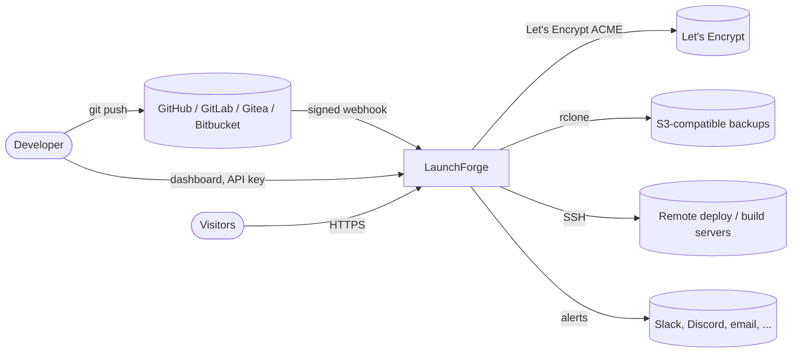
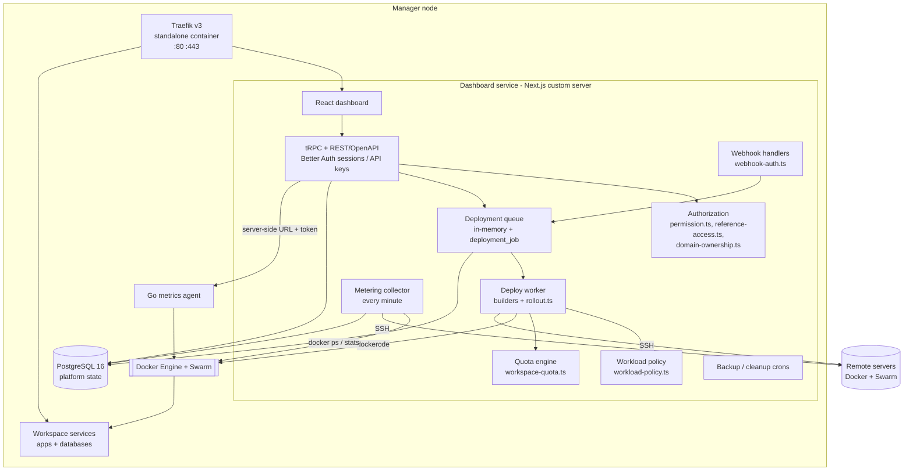
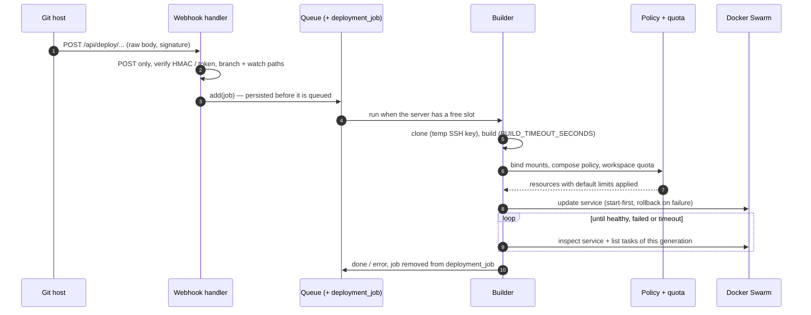

# System Architecture

LaunchForge is a self-hosted Platform-as-a-Service. One **control plane** (dashboard + API) on a manager node turns Git pushes into running Docker Swarm services on the same host or on remote servers, routes traffic to them through Traefik, and keeps several **workspaces** (organizations) isolated from each other on shared hardware.

## Context

## Containers and components

| Component | Code | Responsibility |
|---|---|---|
| Dashboard + API | `apps/dokploy` | UI, tRPC routers, REST via `@dokploy/trpc-openapi`, auth |
| Core services | `packages/server/src/services` | Business logic shared by the API and workers |
| Builders | `packages/server/src/utils/builders` | Nixpacks, Railpack, buildpacks, Dockerfile, static; Swarm service spec |
| Deployment queue | `apps/dokploy/server/queues` | Per-server FIFO with per-service serialization, persisted in `deployment_job` |
| Workload policy | `packages/server/src/utils/security/workload-policy.ts` | Bind mount and compose rules |
| Quota engine | `packages/server/src/services/workspace-quota.ts` | Count, CPU and memory limits per workspace |
| Metering | `packages/server/src/utils/metering/collector.ts` | Hourly usage per workspace |
| Metrics agent | `apps/monitoring` (Go) | Host and container metrics in SQLite |
| Installer | `scripts/install.sh`, `apps/dokploy/bootstrap.ts` | Install, upgrade with rollback, uninstall |

## Deployment data flow

## Trust boundaries

| Boundary | Crossed by | Controls |
|---|---|---|
| Internet → Traefik | Visitor traffic | Host routing only for hosts owned by the routing workspace (`domain-ownership.ts`), TLS |
| Internet → API | Dashboard, API clients, webhooks | Sessions / API keys scoped to one organization; webhooks POST-only with signature or URL token |
| Workspace → workspace | API calls with foreign IDs | `assertServiceInOrganization`, `assertReferencesAccessible`, `checkServiceTargetEnvironment`, host ownership |
| Workload → host | Containers and builds | Workload policy (no socket / host paths / privileged / host namespaces), PIDs limit, build timeout, quota limits |
| Control plane → remote servers | SSH | Per-org server access lists; host key verification is **not implemented yet** |

Known architectural gaps: builds use the host Docker daemon (bounded but not sandboxed); DNS-based domain verification is not implemented.
