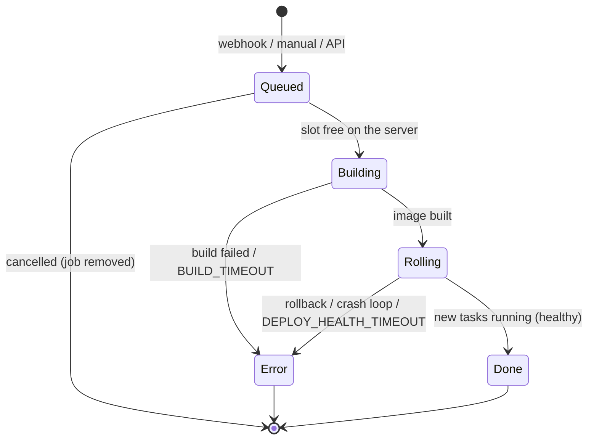

# High-Level Design

## 1. Goals and non-goals

**Goals**
- Deploy any Git repository or image to production on servers the user owns, with HTTPS, logs, metrics, databases and backups.
- Let several workspaces share one installation without being able to read, modify, route to or starve each other.
- Never report a broken deployment as successful; never lose a queued deployment.
- Install, upgrade and roll back with one command.

**Non-goals (current phase)**
- Billing and public self-signup on a shared host (Phase B, blocked on licensing; see `docs/01-discovery/LICENSE_AUDIT.md`).
- Kernel-level sandboxing of untrusted builds (gVisor/Kata).
- Multi-region control plane.

## 2. Architecture overview

See [SYSTEM_ARCHITECTURE.md](../02-architecture/SYSTEM_ARCHITECTURE.md). A single Next.js custom server hosts the dashboard, the tRPC/REST API, WebSocket log streams, the deployment worker and scheduled jobs. State lives in PostgreSQL. Workloads run as Docker Swarm services on the manager node or on remote servers reached over SSH. Traefik terminates TLS and routes by host/path.

## 3. Tenancy model

| Concept | Implementation |
|---|---|
| Platform operator | Owner of the first organization (`isPlatformOperator`) — sets quotas for every workspace |
| Workspace | `organization` |
| Membership | `member` (role owner/admin/member or a custom role, plus per-member access lists) |
| Ownership chain | organization → project → environment → service (application, compose, 6 database engines) → domains, mounts, deployments |
| Org-owned resources | servers, registries, Git providers, SSH keys, destinations, certificates, notifications |

## 4. Request and authorization flow

1. **Authentication** (`validateRequest`, `packages/server/src/lib/auth.ts`): session cookie or `x-api-key`. An API key acts in the organization stored in its metadata and stops working once the owner is no longer a member.
2. **Role permission** (`checkPermission`): static or custom role statements.
3. **Resource ownership**: the target service/project/environment must belong to the active organization (`assertServiceInOrganization`, `checkServiceTargetEnvironment`); members additionally need the resource in their access lists.
4. **Reference ownership** (`assertReferencesAccessible`): every foreign ID in the input (server, registries, SSH key, Git providers, environment) must belong to the organization.
5. **Domain ownership** (`assertHostAvailable`): a hostname is routed by one organization only.
6. **Audit**: mutations write an `audit_log` row; a failed write never fails the operation.

## 5. Deployment lifecycle

- **Queue**: partitioned by server; jobs for the same service run one at a time; per-server concurrency is configurable. Jobs are persisted (`deployment_job`) and restored after a restart.
- **Build**: source clone (deploy keys written to a per-build temp file), build with one of six strategies, optional registry push, bounded by `BUILD_TIMEOUT_SECONDS`. Cancellation kills only that service's build processes.
- **Rollout**: Swarm `start-first` update with automatic rollback; the deploy waits for the new generation to be running/healthy.

## 6. Isolation model

| Layer | Control |
|---|---|
| API | Ownership checks (§4) |
| Routing | Host ownership; raw Traefik labels in compose rejected |
| Filesystem | Bind mounts cannot reach the Docker socket or system directories; optional allow-roots |
| Privileges | Compose: no privileged, host namespaces, devices, dangerous capabilities, unconfined profiles |
| Resources | Per-container PIDs limit; per-workspace CPU/memory quotas with default limits; build timeout |
| Secrets | Encrypted at rest; never in rollback snapshots in plaintext |
| Network | Private overlay network per workspace (`lf-ws-<organizationId>`); Traefik is the only shared member |

## 7. Quotas and metering

- **Quotas** (`workspace_quota`): CPU, memory, application, database and domain limits; enforced on create (counts) and deploy (resources). See ADR-008.
- **Metering** (`workspace_usage`): per-minute sampling aggregated hourly per workspace; 90-day retention. See ADR-009.
- **UI**: Settings → Usage & Quotas shows reservations against quota and hourly usage; the operator edits quotas for every workspace.

## 8. Observability

Build logs on disk per deployment; live container logs and terminals over WebSockets with container-ownership checks; host/container metrics from the Go agent (fetched server-side with the agent's token, never from client-supplied URLs); audit log per organization; notifications to 12 channels; optional log/metric shipping via Vector.

## 9. Scalability and failure handling

| Failure | Behavior |
|---|---|
| Dashboard restart | Running deployments marked cancelled; queued jobs restored from `deployment_job` |
| New version unhealthy | Swarm rolls back; deployment marked error; previous version keeps serving |
| Build hangs | Killed after `BUILD_TIMEOUT_SECONDS` |
| Audit write fails | Logged; the user's operation succeeds |
| Metering host unreachable | That host is skipped for the minute |
| Upgrade fails | Installer rolls the dashboard service back; pre-upgrade database backup on disk |

Scaling: workloads scale across Swarm nodes and remote servers; build concurrency is per server. The control plane is a single replica (state in Postgres; the in-memory scheduler assumes one dashboard instance).

## 10. Technology choices

TypeScript end to end (Next.js 16, React 19, tRPC 11, Zod 4), PostgreSQL 16 with Drizzle ORM, Better Auth, Dockerode, Docker Swarm, Traefik v3, Go for the metrics agent, Vitest, k6, GitHub Actions + GHCR. Rationale for the non-obvious ones is in the ADRs.
