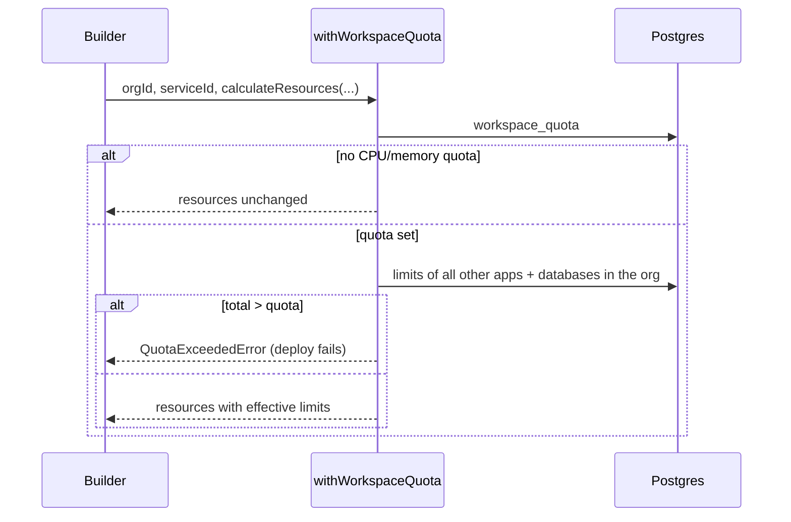
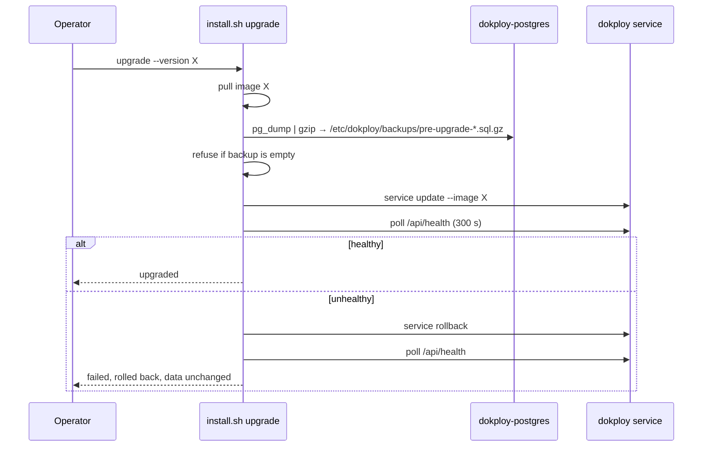

# Low-Level Design

One section per module added or rewritten for LaunchForge. Paths are relative to the repository root; tests live under `apps/dokploy/__test__/`.

---

## 1. Reference access — `packages/server/src/services/reference-access.ts`

**Responsibility.** Reject any procedure input that points a service at a resource owned by another organization.

```ts
assertReferencesAccessible(ctx: PermissionCtx, input: object): Promise<void>
```

| Input key | Check |
|---|---|
| `environmentId` | `checkServiceTargetEnvironment` (org + project access + `service.create`) |
| `serverId`, `buildServerId` | in `getAccessibleServerIds(session)` |
| `registryId`, `rollbackRegistryId`, `buildRegistryId` | `registry.organizationId` = active org |
| `customGitSSHKeyId` | `ssh-key.organizationId` = active org |
| `githubId`, `gitlabId`, `giteaId`, `bitbucketId` | provider row → `gitProviderId` ∈ `getAccessibleGitProviderIds(session)` |

Unknown keys are ignored, so the function is called with the raw input after `checkServicePermissionAndAccess` in every procedure of the eight service routers. Errors: `TRPCError UNAUTHORIZED "You are not authorized to use this <resource>"`.

Related: `checkServiceTargetEnvironment(ctx, environmentId)` in `permission.ts` (used by every `move`), `project.duplicate` checks each selected source service, and the `apiUpdate*` schemas omit `environmentId`.

**Tests:** `permissions/reference-access.test.ts`.

---

## 2. Domain ownership — `packages/server/src/services/domain-ownership.ts`

```ts
normalizeHost(host: string): string        // trim, lowercase, strip trailing dot, punycode
normalizePath(path?: string | null): string // "" → "/", strip trailing slashes
assertHostAvailable(host, path, target: DomainTarget, excludeDomainId?): Promise<void>
organizationOfDomainTarget(target): Promise<string | undefined>
```

Algorithm of `assertHostAvailable`:
1. Select domains whose normalized host equals the input (excluding `excludeDomainId`), joined to their application / compose / preview application.
2. Resolve every row's organization (environment → project) and the organization of the new domain's target.
3. Any row from a different organization → `CONFLICT "<host> is already in use by another workspace"`.
4. Same organization and same normalized path → `CONFLICT "<host><path> is already routed to another service"`.

Called by `createDomain` and `updateDomainById` (when host or path changes). `project.duplicate` skips copied domains that conflict.

**Tests:** `domains/host-ownership.test.ts`.

---

## 3. Webhook authentication — `apps/dokploy/server/utils/webhook-auth.ts`

```ts
readRawBody(req): Promise<Buffer>              // limit 25 MB → WebhookBodyTooLargeError
parseWebhookBody(raw, contentType): unknown     // JSON or GitHub form-encoded payload=
verifyWebhookSignature(headers, raw, secret): "verified" | "unsigned" | "invalid"
```

Signature precedence (first header present wins):

| Header | Scheme |
|---|---|
| `X-Gitlab-Token` | constant-time equality with the secret |
| `X-Gitea-Signature` / `X-Gogs-Signature` | hex HMAC-SHA256 of the raw body |
| `X-Hub-Signature-256` / `X-Hub-Signature` | `sha256=` + hex HMAC-SHA256 (GitHub, Bitbucket) |
| none | `unsigned` |

Handlers (`pages/api/deploy/[refreshToken].ts`, `deploy/compose/[refreshToken].ts`) set `bodyParser: false`, accept POST only (405 otherwise), use the URL token as the secret, accept `unsigned`, reject `invalid` with 401. The GitHub App handler (`deploy/github.ts`) requires a valid `X-Hub-Signature-256` with the installation's webhook secret over the raw body.

**Tests:** `deploy/webhook-auth.test.ts`, `deploy/refresh-token-handler.test.ts` (405/401/200), `deploy/github-webhook-handler.test.ts` (real HMAC).

---

## 4. Rollout gating — `packages/server/src/utils/builders/rollout.ts`

```ts
evaluateRollout(service, tasks, generation): {state: "pending"} | {state: "healthy"} | {state: "failed", reason}
waitForRollout(docker, appName, generation, timeoutMs = rolloutTimeoutMs(), pollMs = 2000): Promise<void>
```

`generation` is the service's `ForceUpdate` counter set by `mechanizeDockerContainer`. Decision table (evaluated in order):

| Condition | Verdict |
|---|---|
| No tasks of this generation yet | update state treated as `updating` (stale status ignored) |
| `UpdateStatus` `rollback_started` / `rollback_completed` | failed: rolled back |
| `UpdateStatus` `paused` | failed: paused |
| ≥ 3 tasks of this generation `failed`/`rejected` | failed: crash loop (last task error) |
| Desired replicas = 0 | healthy |
| running tasks ≥ desired replicas and update `completed`/absent | healthy |
| otherwise | pending |

`waitForRollout` throws `Deployment failed: …` on failure or after `DEPLOY_HEALTH_TIMEOUT_SECONDS` (default 120).

**Tests:** `deploy/rollout.test.ts`.

---

## 5. Build timeout and cancellation — `packages/server/src/utils/builders/build-timeout.ts`

```ts
buildCancelPattern(type: "application" | "compose", appName): string
killBuildProcesses(type, appName, serverId?): Promise<void>   // pkill -2 -f -- <pattern>
runWithBuildTimeout<T>(run, onTimeout, timeoutMs = buildTimeoutMs()): Promise<T>
```

Pattern: applications `(docker (buildx )?build|nixpacks build|pack build|railpack).*<escaped appName>`; compose `docker compose.*-p <escaped appName>`. `runWithBuildTimeout` races the build against a timer; on expiry it calls `onTimeout` (kill) and rejects with `BuildTimeoutError`. Wired into the four application and six compose execution sites. `BUILD_TIMEOUT_SECONDS` (default 3600, `0` disables).

**Tests:** `queues/build-cancel.test.ts`, `deploy/build-timeout.test.ts`.

---

## 6. Durable queue — `apps/dokploy/server/queues/in-memory-queue.ts`, `job-store.ts`

```ts
interface JobStore {
  save(id: string, data: DeploymentJob): Promise<void>;
  remove(ids: string[]): Promise<void>;
  loadAll(): Promise<Array<{ id: string; data: DeploymentJob }>>;
}
InMemoryQueue.restore(): Promise<number>
```

Lifecycle: `add` → `store.save` (awaited) → enqueue. Job finished (success or failure), `remove`, `removeWaiting`, `clearWaiting` → `store.remove` (fire and log). `startDeploymentWorker` calls `restore()` then `run()`. Job ids are `job-<uuid>` so restored and new jobs never collide. `postgresJobStore` uses table `deployment_job`.

**Tests:** `queues/durable-queue.test.ts`, `queues/in-memory-queue.test.ts`.

---

## 7. Workload policy — `packages/server/src/utils/security/workload-policy.ts`

```ts
bindMountViolation(hostPath): string | null
assertBindMountAllowed(hostPath): void                 // throws WorkloadPolicyError
composePolicyViolations(spec, { appName, domainKeys }): string[]
assertComposeAllowed(spec, context): void
isPermissiveWorkloadPolicy(): boolean                  // WORKLOAD_POLICY=permissive
```

Bind mounts: must be absolute; normalized with `path.posix.normalize`; rejected inside `/`, `/bin`, `/boot`, `/dev`, `/etc`, `/lib*`, `/proc`, `/root`, `/run`, `/sbin`, `/sys`, `/usr`, `/var/lib/docker`, `/var/lib/containerd`, `/var/run`, or any `*docker.sock`; when `BIND_MOUNT_ALLOWED_ROOTS` is set, must be under one of them.

Compose, per service: `privileged`; `network_mode|pid|ipc|userns_mode|uts|cgroup` = `host` or `container:*`; `cap_add` of `ALL, SYS_ADMIN, SYS_MODULE, SYS_PTRACE, SYS_RAWIO, SYS_BOOT, SYS_TIME, NET_ADMIN, DAC_READ_SEARCH, MAC_ADMIN, MAC_OVERRIDE, BPF, PERFMON`; any `devices`; `security_opt` containing `unconfined` or `label:disable`; `extends.file`; bind volumes (short or long syntax) failing the bind rule, starting with `~`, or escaping the project with `..`; labels starting `traefik.` other than `traefik.enable`, `traefik.docker.network`, `traefik.swarm.network` and the router/service/middleware labels LaunchForge generates for the compose's current domains (unless `ALLOW_COMPOSE_TRAEFIK_LABELS=true`). Top-level `include` is rejected.

Enforcement points: `createMount`/`updateMount` (400), `generateBindMounts` at deploy, `addDomainToCompose` before labels are added (deploy fails with the list of violations).

Also: `containerPidsLimit()` in `utils/docker/utils.ts` adds `Resources.Limits.Pids` (`CONTAINER_PIDS_LIMIT`, default 4096).

**Tests:** `mounts/workload-policy.test.ts`.

---

## 8. Quota engine — `packages/server/src/services/workspace-quota.ts`

```ts
getWorkspaceQuota(orgId) / setWorkspaceQuota(input)
workspaceAllocation(orgId, excludeServiceId?): { memoryBytes, nanoCpus, counts }
withWorkspaceQuota(orgId, serviceId, resources): Promise<ResourceRequirements>
assertServiceCountQuota(environmentId, "application" | "database")
assertDomainCountQuota(orgId)
isPlatformOperator(userId)
getWorkspaceUsageSummary(orgId, hours = 24)
```

`withWorkspaceQuota`: if the workspace has no CPU/memory quota, return resources unchanged. Otherwise take this service's limits (or the defaults), sum every other application and database at their effective limits, and throw `QuotaExceededError` (`FORBIDDEN`) if memory or CPU would exceed the quota; return resources with the effective limits applied. Wired into `mechanizeDockerContainer` and the six database builders. Count checks run at the start of the nine create functions and in `createDomain`.



**Tests:** `quotas/workspace-quota.test.ts`.

---

## 9. Metering — `packages/server/src/utils/metering/collector.ts`

```ts
parseMemoryMb(memUsage) / parseCpuCores(cpuPerc)
aggregateSamples(psOutput, statsOutput): OrganizationSample[]
recordSamples(samples, at = new Date())
collectWorkspaceUsage()
initWorkspaceMetering()   // "* * * * *" sample, "17 3 * * *" retention
```

`aggregateSamples` maps container ID prefixes (12 chars) to the `dokploy.organization.id` label from `docker ps`, sums CPU cores and memory per organization from `docker stats` JSON lines, and ignores unlabelled containers. `recordSamples` upserts the hour row: `samples + 1`, `cpu_core_seconds + cores × 60`, running average memory, `greatest` for peak memory and containers.

**Tests:** `quotas/metering.test.ts`.

---

## 10. Secrets at rest

- Columns switched to `encryptedText` are listed in [ER_DIAGRAM.md](../04-database/ER_DIAGRAM.md#encrypted-columns).
- `sealRollbackContext` / `openRollbackContext` (`services/rollbacks.ts`): snapshot secret fields (`env`, build args/secrets, `password`, environment and project env) are encrypted inside the jsonb; registry objects are removed and re-read with credentials by id at rollback.
- `writeTemporarySshKeyCommand` (`utils/providers/git.ts`): `mktemp` file, `trap` removal on exit, key written via base64.
- `generatePassword` uses `crypto.randomInt`.

**Tests:** `services/rollback-snapshot.test.ts`.

---

## 11. Audit log and custom roles

- `createAuditLog(input)` (`services/audit-log.ts`) always writes; errors are logged and swallowed. `getAuditLogs({organizationId, limit, offset, action?, resourceType?, userEmail?, from?, to?})` returns `{logs, total}`.
- `customRole` router: names `^[a-z0-9][a-z0-9_-]{1,31}$` (not owner/admin/member); permissions validated against `statements`; at most 10 per organization; a role in use cannot be deleted.

**Tests:** `audit-log/create-audit-log.test.ts`, `permissions/server-terminal.test.ts` (custom roles resolve without a license).

---

## 12. Installer — `scripts/install.sh`

Commands `install | upgrade | uninstall | status`. Install steps and their idempotency checks: preflight → Docker (`docker info`) → Swarm (`LocalNodeState`) → network (`network inspect`) → secrets (`secret inspect`) → Postgres (`service inspect`) → image (pull, or local with `LAUNCHFORGE_SKIP_PULL=1`) → Traefik image + `node dist/bootstrap.mjs` → dashboard service → `/api/health` (300 s).



**Tests:** `.github/workflows/installer.yml` (ShellCheck; install, re-install, upgrade, uninstall on Ubuntu 22.04/24.04).
