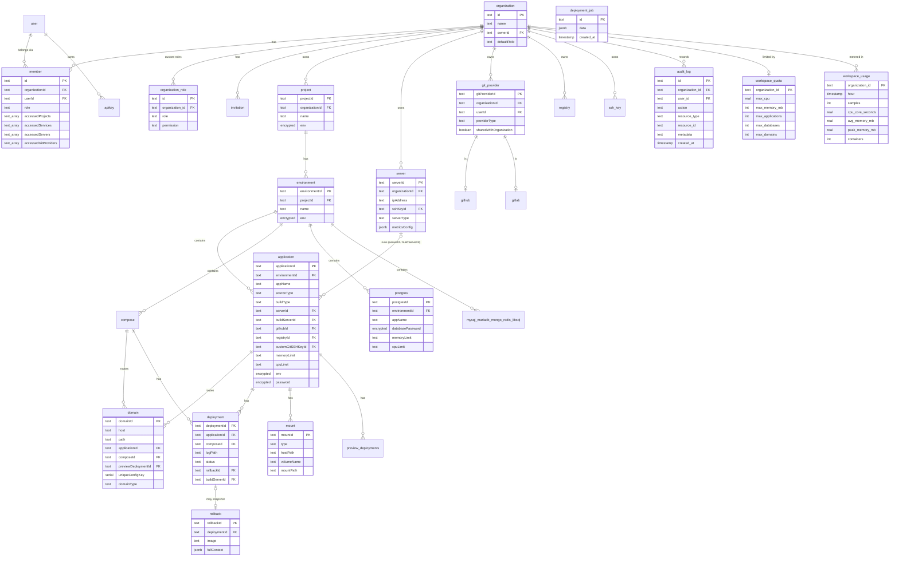

# Database: Entity-Relationship Model

PostgreSQL 16, schema defined with Drizzle in `packages/server/src/db/schema/`, migrations in `apps/dokploy/drizzle/` (applied at start by `apps/dokploy/migration.ts`). The full schema has 70+ tables; the diagram shows the ownership model and every table LaunchForge added.

## Core ownership model

`mysql_mariadb_mongo_redis_libsql` stands for the five other database tables, which have the same shape as `postgres`. Services do not store `organizationId`; it is resolved through `environment → project` (ADR-002).

## Tables added by LaunchForge

| Table | Purpose | Key / indexes | Migration |
|---|---|---|---|
| `deployment_job` | Queued deployments not yet finished; replayed on start | PK `id`; index `created_at` | `0199_deployment_job.sql` |
| `workspace_quota` | Per-organization limits (null = unlimited) | PK `organization_id` → `organization` (cascade) | `0200_workspace_quota_usage.sql` |
| `workspace_usage` | Hourly usage per organization | unique `(organization_id, hour)` for upserts; FK cascade | `0200_workspace_quota_usage.sql` |

`audit_log` and `organization_role` existed upstream; LaunchForge now writes and manages them without a license gate.

## Encrypted columns

Stored as `enc:v1:<base64(iv | tag | ciphertext)>` (AES-256-GCM) through the `encryptedText` column type; plaintext rows from older versions are read as-is and encrypted on their next write.

| Table | Columns |
|---|---|
| application | `env`, `previewEnv`, `buildArgs`, `buildSecrets`, `previewBuildArgs`, `previewBuildSecrets`, `password` |
| compose, project, environment | `env` |
| postgres, mongo, redis, libsql | `env`, `databasePassword` |
| mysql, mariadb | `env`, `databasePassword`, `rootPassword` |
| ssh-key | `privateKey` |
| registry | `password` |
| destination | `accessKey`, `secretAccessKey` |
| github | `githubClientSecret`, `githubPrivateKey`, `githubWebhookSecret` |
| gitlab, gitea | `secret`/`client_secret`, `access_token`, `refresh_token` |
| bitbucket | `appPassword`, `apiToken` |
| certificate | `privateKey` |
| ai | `apiKey` |
| webServerSettings | `sshPrivateKey` |
| telemetryProvider | `endpoint`, `apiKey`, `apiSecret` |

Still plaintext: notification channel tokens/webhook URLs, vault and DNS provider `config` jsonb, and the per-service webhook `refreshToken` (used as a lookup key).
