# Demo walkthrough

Recorded automatically by the [Demo video workflow](../.github/workflows/demo.yml): a fresh GitHub-hosted Ubuntu 24.04 runner, LaunchForge installed with the real installer, then [`tests/demo/demo.mjs`](../tests/demo/demo.mjs) drives the dashboard with Playwright. Nothing is mocked — the app below was really deployed and served.

**▶ [Watch the video (MP4)](assets/demo/launchforge-demo.mp4)**

| # | Step | What it shows |
|---|---|---|
| 1 | One-command install | Real installer output from the same server |
| 2 | Owner account | First user becomes the platform operator |
| 3 | Projects | Projects → environments → services |
| 4 | Deploy an application | Docker-image source, Deploy / Rebuild / Stop, Autodeploy |
| 5 | Domain and live site | Traefik routes `portfolio.127.0.0.1.sslip.io` to the container |
| 6 | Logs | Live container logs |
| 7 | Database | Managed PostgreSQL next to the app |
| 8 | Workload policy | Mounting the Docker socket is rejected |
| 9 | Signed webhooks | GET → 405; unsigned GitHub delivery → 401 |
| 10 | Quotas and usage | Reserved resources against quota; hourly metering |
| 11 | Custom roles | A `deployer` role with exactly three permissions |
| 12 | Audit log | Every action above, attributed |
| 13 | Monitoring | Server metrics |

## Screens

### Create the owner account
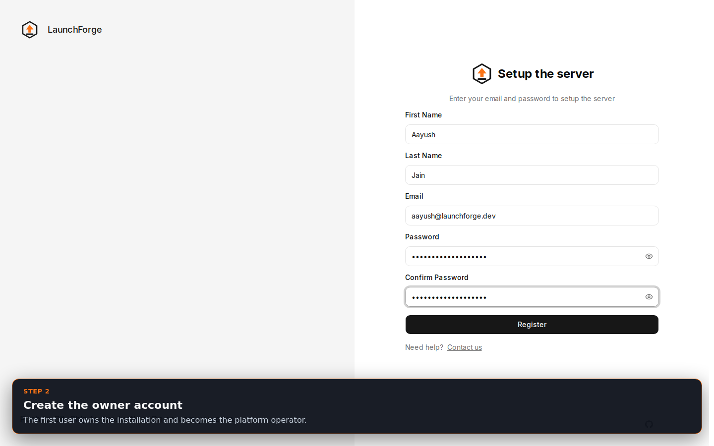

### Projects
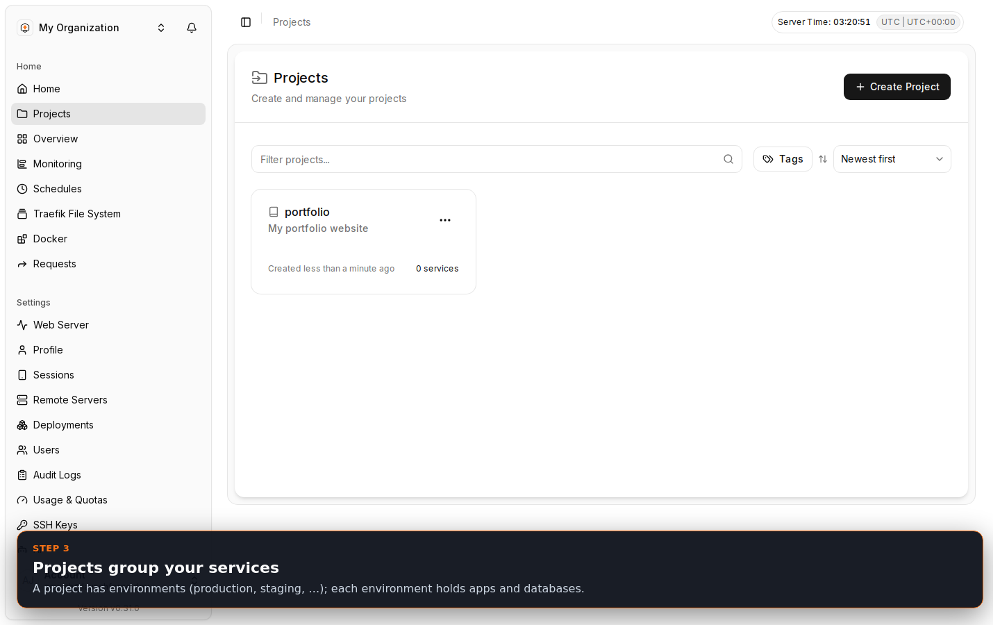

### Application: deploy settings and source
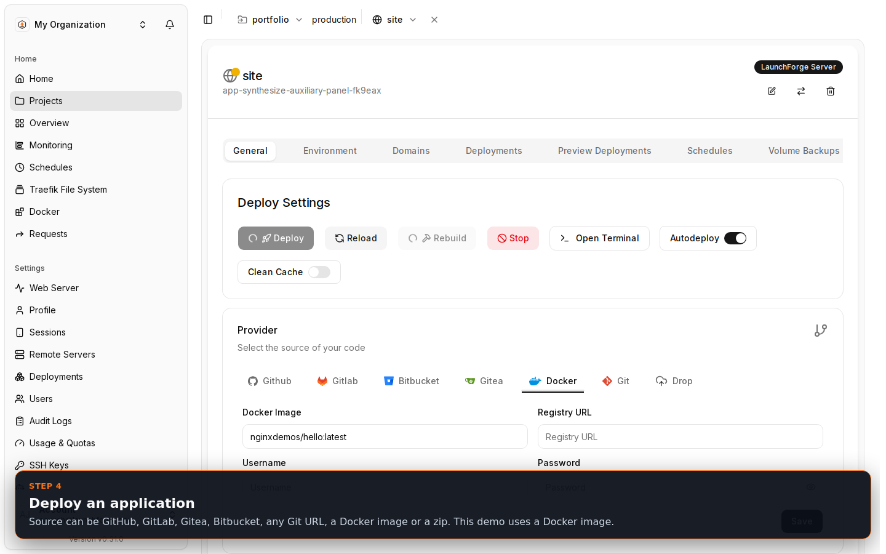

### Deployment finished
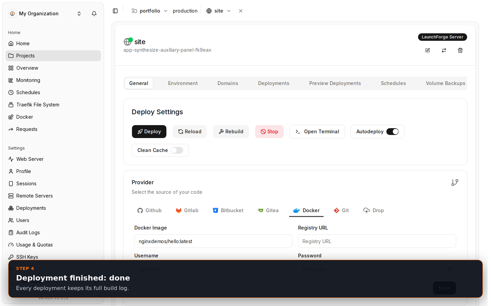

### Domains
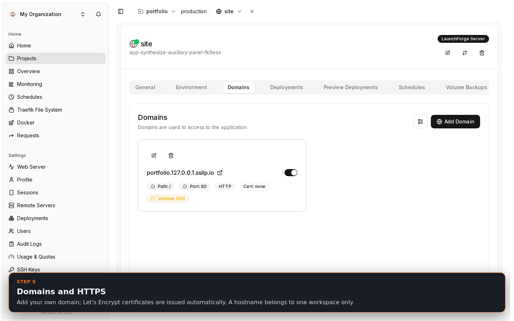

### The deployed app, served through Traefik
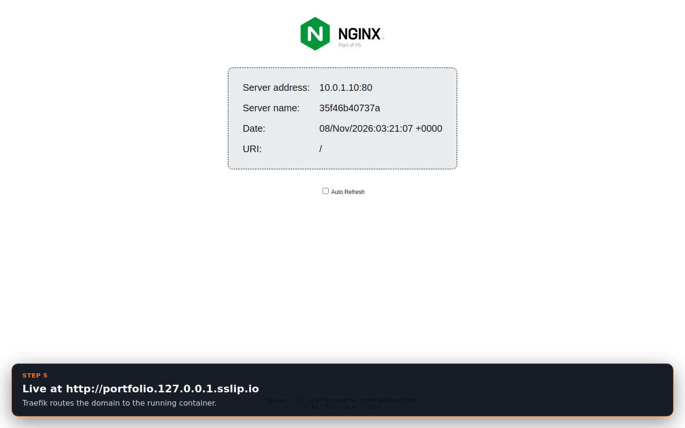

### Live logs
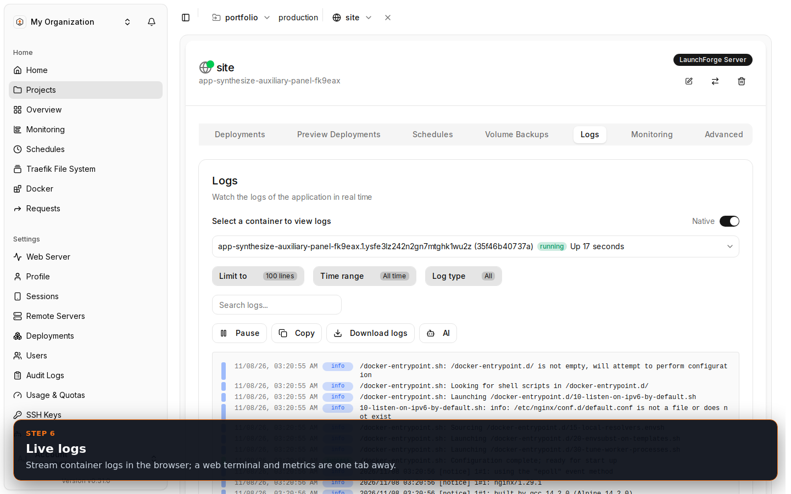

### Environment with the app and a PostgreSQL database
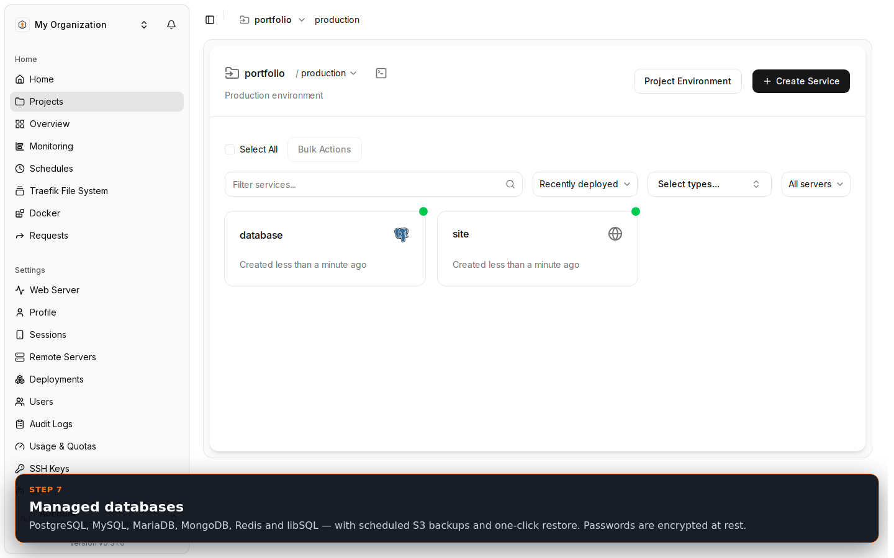

### Usage & Quotas (operator view)
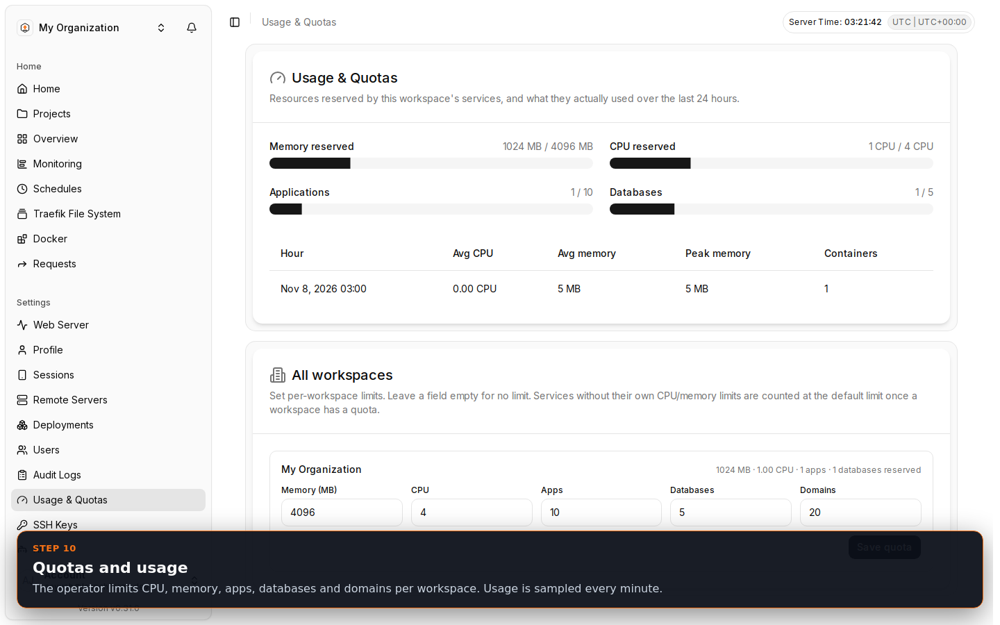

### Users and custom roles
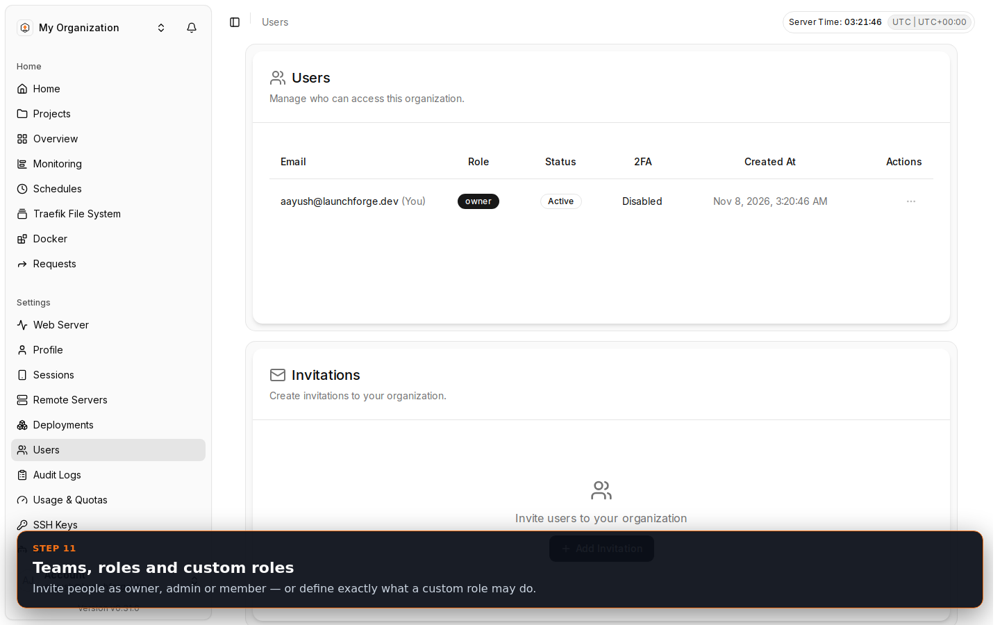

### Audit log
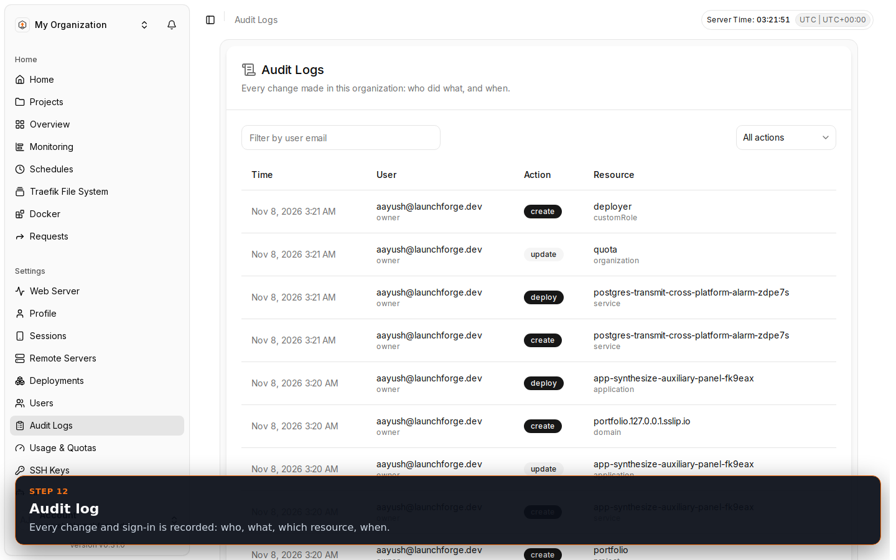

### Monitoring
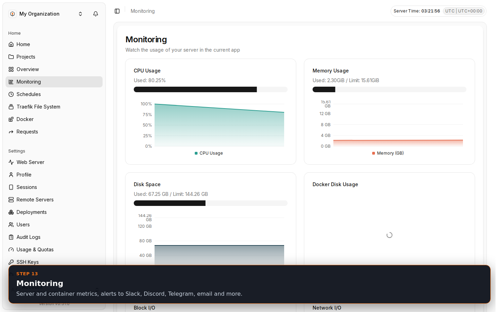
