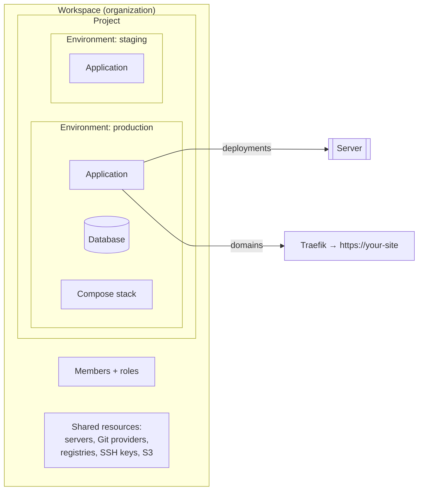

# 1. Concepts

## The mental model

A **workspace** holds **projects**; a project holds **environments**; an environment holds **services** (applications, databases, compose stacks). Each service runs on a **server** and can have **domains**. Every change to a service's code or settings is rolled out as a **deployment**.

## Glossary

| Term | Meaning |
|---|---|
| **Workspace** | A team's private area (technically an *organization*). Members of one workspace cannot see or touch another's resources. You can belong to several and switch between them. |
| **Platform operator** | The first person who signed up on the installation. Can set quotas for every workspace. |
| **Project** | A group of related services, e.g. "portfolio" or "shop". |
| **Environment** | A copy of a project's services with its own variables: `production`, `staging`, `preview`. Every project starts with one. |
| **Service** | Anything that runs: an application, a database, or a compose stack. |
| **Application** | One container image built from Git, a Docker image, or an uploaded zip. |
| **Compose** | A multi-container app described by a `docker-compose.yml`. |
| **Database** | A managed PostgreSQL, MySQL, MariaDB, MongoDB, Redis or libSQL instance with backups. |
| **Build type** | How source code becomes an image: Nixpacks (auto-detect), Railpack, Heroku buildpacks, Paketo buildpacks, Dockerfile, or static files. |
| **Deployment** | One build-and-rollout of a service. It has a log, a status (running, done, error, cancelled) and, if enabled, a rollback point. |
| **Rollout** | Replacing the running version with the new one. LaunchForge starts the new version first and switches over only when it is running (and healthy, if you set a health check). |
| **Domain** | A hostname (and optional path) routed to a service. HTTPS certificates are issued automatically. |
| **Server** | A machine that runs services. The installation's own machine is always available; you can add remote servers over SSH. |
| **Build server** | A remote server used only for building images, to keep builds away from your apps. |
| **Git provider** | A connected GitHub App, GitLab, Gitea or Bitbucket account used to clone repositories and receive push events. |
| **Webhook** | The URL a Git host calls on every push so LaunchForge can deploy automatically. |
| **Registry** | A Docker registry used to store built images or pull private ones. |
| **S3 destination** | Any S3-compatible bucket used for backups. |
| **Quota** | Limits the operator sets per workspace: CPU, memory, number of apps, databases and domains. |
| **Workload policy** | Safety rules applied to every service: no Docker socket or system directories mounted, no privileged containers, no host networking. |
| **Audit log** | A record of every change: who did what to which resource, and when. |

## What happens when you push code

1. GitHub (or another host) sends a signed webhook to LaunchForge.
2. LaunchForge checks the signature, the branch and any watch paths, then queues a deployment. The queue survives restarts.
3. A worker clones the repository and builds an image (time-limited).
4. The image runs as a new version of your service next to the old one.
5. When the new version is running and healthy, traffic moves to it and the old one stops. If it crashes or fails its health check, the old version keeps serving and the deployment is marked as failed.
6. You get a notification (Slack, Discord, email, …) either way.

## What LaunchForge is not

- Not a Kubernetes distribution: it uses Docker Swarm, which is simpler to run on one to a few servers.
- Not a hosted service: you run it on your own servers.
- Not a serverless platform: services are long-running containers.
