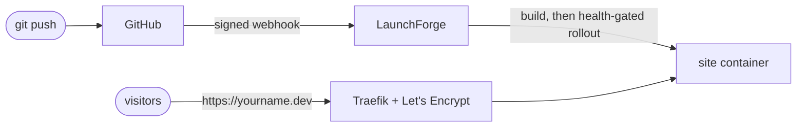

# 3. Tutorial: deploy your portfolio

By the end, `git push` to your portfolio repository updates `https://yourname.dev` within a minute or two, with HTTPS, zero downtime and one-click rollback.

You need:

- LaunchForge installed on a server ([Quickstart](02-quickstart.md), or [for free on Oracle Cloud](13-free-hosting.md))
- Your portfolio in a GitHub repository (GitLab, Gitea, Bitbucket and plain Git URLs work the same way)
- A domain. No domain yet? Use a free subdomain from [DuckDNS](https://www.duckdns.org) or [is-a.dev](https://www.is-a.dev), or skip the domain and use a generated `sslip.io` address (HTTP only) to try things out.

## Step 1: Point the domain at the server

At your DNS provider, create these records with your server's public IP:

| Type | Name | Value |
|---|---|---|
| A | `@` (the bare domain, `yourname.dev`) | server IP |
| A | `www` | server IP |

Check that it resolves before going on. Let's Encrypt cannot issue a certificate until it does:

```bash
dig +short yourname.dev        # must print the server IP
```

On Cloudflare, set the records to **DNS only** (grey cloud) for the first certificate; you can turn the proxy back on afterwards.

## Step 2: Connect GitHub

**Settings → Git → GitHub → Create GitHub App.** LaunchForge sends you to GitHub with the app pre-filled. Confirm, then **Install** it on your account and select the portfolio repository.

The app gives LaunchForge read access to that repository and sends a signed webhook on every push. LaunchForge rejects webhook deliveries whose signature does not match, so nobody else can trigger your deployments.

A public repository also works without the app: choose **Provider: Git** and paste the HTTPS URL. You then deploy by hand or through a [deploy webhook](11-api.md).

## Step 3: Create the project and the application

1. **Projects → Create Project**, name it `portfolio`. A project starts with a `production` environment.
2. Open it and choose **Create Service → Application**, name it `site`.
3. In **General → Provider**, choose **GitHub**, then the repository and branch `main`.
4. Pick the **build type** and port for your kind of portfolio:

| Your portfolio is… | Build type | Extra setting | Port the app listens on |
|---|---|---|---|
| Plain HTML, CSS and JavaScript | **Static** | none | 80 |
| React, Vite, Vue, Svelte or Angular single-page app | **Nixpacks** | **Publish directory** `dist` (Vite) or `build` (Create React App); the built files are served by nginx | 80 |
| Next.js, Nuxt, Remix, Astro (server mode), SvelteKit | **Nixpacks** | none; it runs `npm run build` then `npm start` | 3000 |
| Next.js with `output: "export"` | **Nixpacks** | **Publish directory** `out` | 80 |
| Anything with a `Dockerfile` | **Dockerfile** | Dockerfile path, usually `Dockerfile` | whatever your `EXPOSE` says |
| Python, Go, PHP, Ruby, Java, Rust | **Nixpacks** | none | your app's port |

5. Click **Save**.

### If you prefer a Dockerfile

This one builds a Vite or React portfolio and serves it with nginx on port 80:

```dockerfile
FROM node:22-alpine AS build
WORKDIR /app
COPY package*.json ./
RUN npm ci
COPY . .
RUN npm run build

FROM nginx:1.27-alpine
COPY --from=build /app/dist /usr/share/nginx/html
EXPOSE 80
```

## Step 4: Environment variables

In the **Environment** tab, add what your site reads at build or run time, one per line:

```env
NODE_ENV=production
NEXT_PUBLIC_CONTACT_EMAIL=you@example.com
```

Values are encrypted in the database. For a static site, variables that must end up in the browser (`VITE_*`, `NEXT_PUBLIC_*`) are read at **build** time, so redeploy after changing them.

## Step 5: Add a health check (recommended)

**Advanced → Swarm Settings → Health Check**:

```json
{
  "Test": ["CMD-SHELL", "wget -qO- http://localhost:80/ || exit 1"],
  "Interval": 10000000000,
  "Timeout": 5000000000,
  "Retries": 3,
  "StartPeriod": 15000000000
}
```

Use your app's port in the URL; durations are in nanoseconds. With a health check, a release that starts but serves errors never takes traffic: LaunchForge waits for it to pass, and if it does not, the previous version keeps serving and the deployment is marked as failed.

## Step 6: Deploy

Click **Deploy** and open the **Deployments** tab to follow the build log live. A deployment is **done** only once the new version runs and passes its health check.

A first build takes one to three minutes; later builds reuse the cache.

## Step 7: Domain and HTTPS

**Domains → Add Domain**:

| Field | Value |
|---|---|
| Host | `yourname.dev` |
| Path | `/` |
| Container port | the port from step 3 (80 or 3000) |
| HTTPS | on |
| Certificate | Let's Encrypt |

Add `www.yourname.dev` the same way, or redirect it to the bare domain with a redirect rule (see [Domains](06-domains.md)). The certificate arrives within about a minute of the DNS record resolving. Open `https://yourname.dev`.

A hostname belongs to one workspace only. If someone else on the same installation already uses it, adding it is refused.

## Step 8: Deploy on every push

Turn on **General → Autodeploy** and push a change:

```bash
git commit -am "Update projects section" && git push
```

A new deployment starts within seconds. If the build fails or the new version is unhealthy, the old one keeps serving.

Optional extras:

- **Watch paths** such as `src/**` and `public/**`: deploy only when these change, not when you edit the README.
- **Preview deployments**: every pull request gets its own URL, removed when the pull request closes.
- **Notifications** (**Settings → Notifications**): a Slack, Discord, Telegram or email message for every deployment.

## Step 9: Roll back

Under **Advanced → Rollback Settings**, enable rollbacks and choose a registry. LaunchForge then keeps the image of every deployment, and **Deployments → Rollback** on any earlier deployment brings it back in seconds, without rebuilding.

## Troubleshooting

| What you see | Cause and fix |
|---|---|
| Build log ends with `npm ERR! missing script: build` | Nixpacks runs `npm run build`. Add a `build` script, or use the Static build type for plain HTML. |
| Site shows *404 page not found* | The domain's container port does not match the port the app listens on. Fix it in **Domains**. |
| Site shows *Bad Gateway* | The container is starting or crashed. Check **Logs**; the app must listen on `0.0.0.0`, not `localhost`. |
| Browser warns about the certificate | DNS did not resolve to the server when the domain was added. Fix DNS, then edit and save the domain to retry. |
| Deployment stuck on *health check* | The health check URL or port is wrong, or the app takes longer than `StartPeriod` to boot. |
| React routes 404 on refresh | Use the **Publish directory** option (nginx falls back to `index.html`), not `npm start`. |
| `Memory quota exceeded` or `CPU quota exceeded` when deploying | The workspace reached its limit. Lower the service's memory or CPU limit, stop another service, or ask the operator for more (**Settings → Usage & Quotas**). |

More in [Troubleshooting](12-troubleshooting.md).

## What you have now


