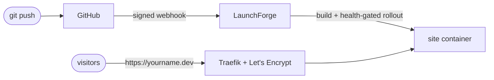

# 3. Tutorial: deploy your portfolio

Goal: `git push` to your portfolio repository updates `https://yourname.dev` within a minute or two, with zero downtime.

Assumes LaunchForge is installed ([Quickstart](02-quickstart.md)) and you own a domain.

## Step 1 — Point the domain at the server

At your DNS provider create:

| Type | Name | Value |
|---|---|---|
| A | `@` (yourname.dev) | server IP |
| A | `www` | server IP |

## Step 2 — Connect GitHub

**Settings → Git → GitHub → Create GitHub App.** LaunchForge sends you to GitHub with the app manifest pre-filled; confirm, then **Install** it on your account and select the portfolio repository. The app gives LaunchForge read access to the code and sends a signed webhook on every push.

## Step 3 — Create the project and application

1. **Projects → Create Project** → `portfolio`.
2. **Create Service → Application** → `site`.
3. **General → Provider: GitHub** → pick the repository and branch `main`.
4. **Build type**:

| Your portfolio is… | Choose |
|---|---|
| Next.js / Nuxt / Astro / Remix (server) | Nixpacks |
| React/Vite/Angular SPA | Nixpacks, then set **Publish directory** to `dist` (or `build`) so it is served by nginx |
| Plain HTML/CSS/JS | Static |
| Anything with a Dockerfile | Dockerfile |

5. **Environment** tab: add variables, e.g. `NODE_ENV=production`, `CONTACT_EMAIL=you@example.com`. Values are encrypted at rest.

## Step 4 — Add a health check (recommended)

**Advanced → Swarm Settings → Health Check**:

```json
{
  "Test": ["CMD-SHELL", "wget -qO- http://localhost:3000/ || exit 1"],
  "Interval": 10000000000,
  "Timeout": 5000000000,
  "Retries": 3,
  "StartPeriod": 15000000000
}
```

(Durations are in nanoseconds; adjust the port.) With a health check, a release that starts but serves errors is detected and rolled back automatically instead of going live.

## Step 5 — Deploy

Click **Deploy** and watch **Deployments**. The deployment is marked **done** only once the new version is running and healthy.

## Step 6 — Domain and HTTPS

**Domains → Add Domain**:

| Field | Value |
|---|---|
| Host | `yourname.dev` |
| Path | `/` |
| Container port | the port your app listens on (3000 for Next.js, 80 for static/nginx) |
| HTTPS | on, certificate **Let's Encrypt** |

Repeat for `www.yourname.dev` (or add a redirect, see [Domains](06-domains.md)). The certificate is issued within a minute once DNS resolves to the server.

## Step 7 — Auto-deploy

**General → Autodeploy** on. Push a commit:

```bash
git commit -am "Update projects section" && git push
```

A new deployment appears within seconds. If the build fails or the new version is unhealthy, the old version keeps serving.

Optional:
- **Watch paths** (`src/**`, `public/**`) — only deploy when these change.
- **Preview deployments** — every pull request gets its own URL.
- **Notifications** (Settings → Notifications) — a Slack/Discord/Telegram/email message per deployment.

## Step 8 — Roll back if needed

Enable **Advanced → Rollback Settings** with a registry to keep one image per deployment; then **Deployments → Rollback** on any earlier deployment restores it.

## What you have now


