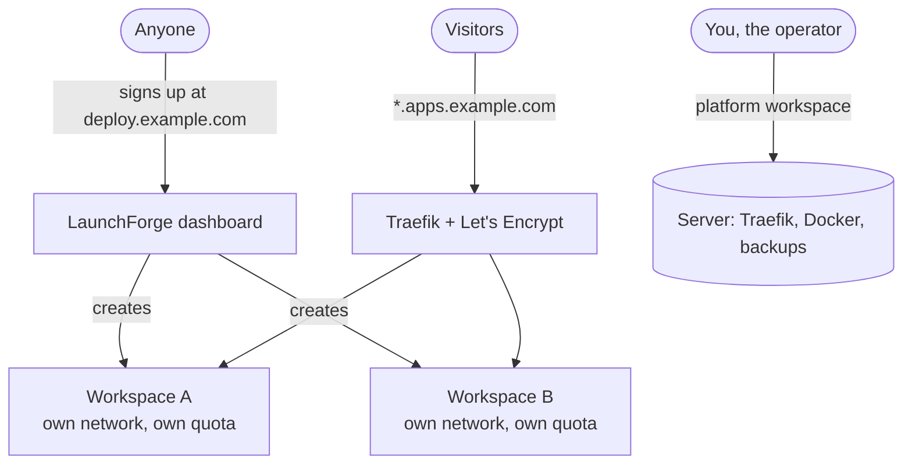

# 14. Run a public platform like Heroku or Render

By default an installation is private: the person who installs it creates the first account, and everyone else joins by invitation. This chapter turns it into a service where anyone can sign up, get their own isolated workspace with a fixed allowance, and deploy apps under your domain, the way Heroku, Render or Railway work.

Read the [security checklist](#security-checklist) before opening sign-ups to strangers.

## How it fits together



Two kinds of workspace exist:

| Workspace | Who | Can do |
|---|---|---|
| **Platform workspace** | The first one, created by the installer's owner account | Everything, including the server itself: Traefik, Docker, Swarm, web server settings, updates, quotas of other workspaces |
| **Tenant workspace** | One per sign-up | Deploy apps and databases inside its quota, invite its own team, connect its own Git accounts and servers. Cannot see or change the server or other workspaces. |

## Step 1: Plan the domains

Use one domain for the dashboard and a wildcard for apps:

| DNS record | Type | Value | Purpose |
|---|---|---|---|
| `deploy.example.com` | A | server IP | The dashboard, where users sign up |
| `*.apps.example.com` | A | server IP | Every app: `blog.apps.example.com`, `api.apps.example.com`, … |

With a wildcard record, users never have to touch DNS: they add a domain such as `myblog.apps.example.com` to their app and Let's Encrypt issues the certificate on the spot. A hostname belongs to whoever claims it first, so one user cannot take over another's address.

Users can still bring their own domains by pointing an `A` record at the server.

No paid domain? DuckDNS gives a free wildcard: `*.yourname.duckdns.org` ([Free hosting](13-free-hosting.md#5-get-a-free-domain-with-https)).

## Step 2: Install and secure the dashboard

1. Install LaunchForge ([Quickstart](02-quickstart.md) or [for free](13-free-hosting.md)).
2. Create the owner account. This account and its workspace become the **platform workspace**.
3. **Settings → Web Server**: set the domain `deploy.example.com` and a Let's Encrypt email. Then close port 3000 in the firewall.
4. Turn on two-factor authentication for the owner account (**Settings → Profile**).

## Step 3: Set the allowance for new workspaces

Every sign-up gets a quota. Choose values that fit your server. On a 24 GB Oracle machine, for example, 1 GB per user leaves room for about twenty active users.

| Variable | Default | Meaning |
|---|---|---|
| `SIGNUP_QUOTA_MEMORY_MB` | 1024 | Memory that a workspace's services may reserve in total |
| `SIGNUP_QUOTA_CPU` | 1 | CPUs that a workspace's services may reserve in total |
| `SIGNUP_QUOTA_APPLICATIONS` | 3 | Applications per workspace |
| `SIGNUP_QUOTA_DATABASES` | 2 | Databases per workspace |
| `SIGNUP_QUOTA_DOMAINS` | 5 | Domains per workspace |
| `DEFAULT_SERVICE_MEMORY_MB` | 512 | Memory limit for a service that does not set one |
| `DEFAULT_SERVICE_CPU` | 0.5 | CPU limit for a service that does not set one |

You can change any single workspace's quota later under **Settings → Usage & Quotas**, which, as the operator, shows every workspace and what it uses.

The memory and CPU quota only covers services running on your servers. A workspace that connects its own server (**Settings → Remote Servers**, then **Setup Server**, which installs Docker and everything else over SSH in one click) can run anything there without touching its quota. That gives your users both options: deploy on your platform within the free allowance, like Render or Railway, or bring a server and use your dashboard to run it, like a hosted control panel.

## Step 4: Turn on email

Password-reset and invitation emails need an SMTP server. Any provider works; Brevo, Resend and Mailjet have free plans. The easiest way is **Settings → Sign-in & Email** in the dashboard: fill in the server and press **Send a test email**. Environment variables work as well:

| Variable | Example |
|---|---|
| `SMTP_SERVER` | `smtp-relay.brevo.com` |
| `SMTP_PORT` | `587` |
| `SMTP_USERNAME` | your SMTP login |
| `SMTP_PASSWORD` | your SMTP key |
| `SMTP_FROM_ADDRESS` | `LaunchForge <no-reply@example.com>` |

## Step 5: Open sign-ups

The quickest way: **Settings → Sign-in & Email → Sign-up → Allow anyone to sign up**. It takes effect immediately.

Alternatively, everything above can be set as environment variables of the dashboard service (`ALLOW_PUBLIC_SIGNUP`, when set to `true` or `false`, overrides the dashboard switch). Apply them on the server in one command:

```bash
sudo docker service update \
  --env-add ALLOW_PUBLIC_SIGNUP=true \
  --env-add SIGNUP_QUOTA_MEMORY_MB=1024 \
  --env-add SIGNUP_QUOTA_CPU=1 \
  --env-add SIGNUP_QUOTA_APPLICATIONS=3 \
  --env-add SIGNUP_QUOTA_DATABASES=2 \
  --env-add SMTP_SERVER=smtp-relay.brevo.com \
  --env-add SMTP_PORT=587 \
  --env-add SMTP_USERNAME=... \
  --env-add SMTP_PASSWORD=... \
  --env-add SMTP_FROM_ADDRESS="LaunchForge <no-reply@example.com>" \
  dokploy
```

The dashboard restarts in a few seconds. The sign-in page now shows **Create an account**, and `https://deploy.example.com/register` accepts anyone. Each new account gets a workspace named after the person, with the quota from step 3.

To close sign-ups again, turn the switch off (or `sudo docker service update --env-rm ALLOW_PUBLIC_SIGNUP dokploy` if you used the variable). Existing workspaces keep working. People who are not invited then see "Sign-up is closed on this server. Ask an admin to invite you."

## What a new user sees

1. They sign up and land in their own empty workspace.
2. They connect GitHub under **Settings → Git**. Each workspace connects its own GitHub App installation, so nobody can deploy someone else's private repositories.
3. They create a project and an application, deploy, and add a domain like `name.apps.example.com`. HTTPS is automatic.
4. **Settings → Usage & Quotas** shows how much of their allowance is reserved and what they actually used in the last 24 hours.

Pages that manage the server itself (Web Server, Traefik, Docker, Swarm, Requests, host Monitoring) are hidden from tenant workspaces and refused by the API if called directly.

## What keeps tenants apart

| Risk | Control |
|---|---|
| Reaching another workspace's databases over the network | Each workspace has its own overlay network; only Traefik joins them all |
| Changing Traefik, Docker or the server | Host administration is limited to the platform workspace |
| Escaping a container through mounts | The Docker socket, `/`, `/etc`, `/var/lib/docker` and similar paths cannot be mounted; privileged containers and host namespaces are rejected |
| Taking someone's domain | A hostname belongs to the first workspace that adds it |
| Using all the memory or CPU | Quotas are checked on every deploy; services without limits get the default limits |
| Forged Git webhooks | Signatures are verified against the raw request body |
| Reading someone's secrets | Environment variables and credentials are encrypted at rest; every API call checks ownership |

The full list, with the tests that prove each control, is in the [threat model](../06-security/THREAT_MODEL.md).

## Security checklist

Before inviting the public, know what is not covered yet:

- **Builds run on the host's Docker daemon.** They are time-limited and cannot mount the host, but a deliberately heavy build can slow the server for others while it runs. Keep `BUILD_TIMEOUT_SECONDS` short (for example 900) and watch **Monitoring**.
- **No email verification or CAPTCHA on self-hosted sign-up.** Expect throwaway accounts on a public URL. Quotas cap what each can use.
- **No suspend or delete button for other workspaces yet.** To contain an abusive workspace, set its quotas to 1 under **Settings → Usage & Quotas** so nothing new deploys, then remove its services with `docker service rm` on the server.
- **No billing.** Every workspace gets the same free allowance.
- **Remote servers are trusted on first SSH connection** (no host-key pinning yet). Only matters if tenants add their own servers.

For a class, a team or a group of friends, these are acceptable today. For an open service on the internet, add a CAPTCHA and email verification in front of sign-up, and consider separate build servers (**Settings → Remote Servers**, type *Build*) so builds never run next to production apps.

## Operating it

| Task | Where |
|---|---|
| See every workspace's usage and change quotas | **Settings → Usage & Quotas** (platform workspace) |
| Watch the server | **Monitoring** |
| Find who changed what | **Settings → Audit Logs** |
| Back up the platform database | [Backup and restore](../09-release/BACKUP_RESTORE.md) |
| Upgrade | `sudo bash install.sh upgrade` ([Upgrade guide](../09-release/UPGRADE_GUIDE.md)) |
| Add capacity | Add a Swarm worker or a remote server ([Servers and scaling](09-servers.md)) |
